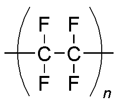
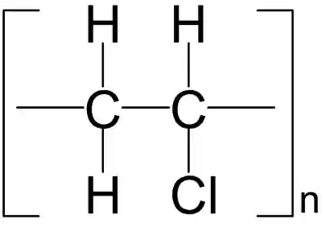
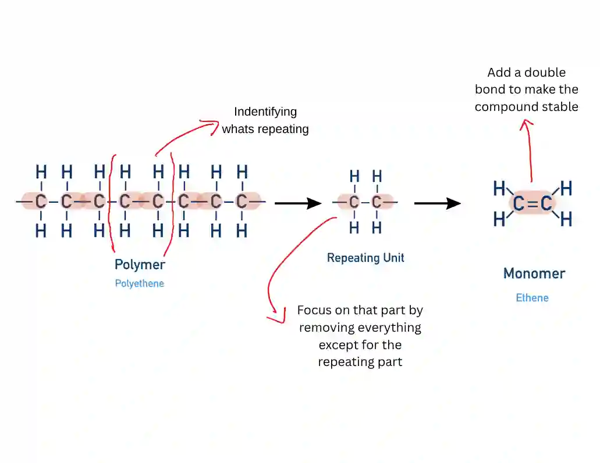

# Polymerisation

## Addition Polymerisation

* Monomers are alkenes; polymer formed is polyalkene

* Alkene joins to itself, no molecule lost

  E.g. $\text{nA}\rightarrow \ \  - A - A - A - A -$ or ­$( - A - )_n$

* Molecular mass of polymer is multiple of monomer

**Physical Properties of Polymers:**

* Only C and H present = only VDW forces present
* Presence of Cl or F = dipoles = permanent dipole interaction
* Longer chains with have fewer side chains have stronger VDW forces
* Examples include:
  * Polyethene
    

  * Polytetrafluoroethylene (PTFE)
    

  * Polyvinyl chloride (PVC)

    

    **Deducing the repeat unit from a given monomer for addition polymers:**

    