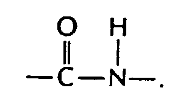
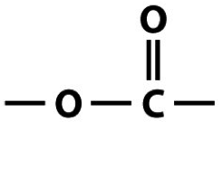

## Condensation Polymerization

* When two different molecules (monomers) react together to form an
  ester or amide bond with the elimination of a small molecule
  (H2O or HCl)

|**Polyamides**|**Polyesters**|
|:---|:---|
|**Monomers joined by amide (peptide) link:**    |**Monomers joined by ester link:**    |
