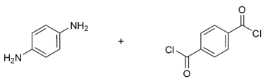
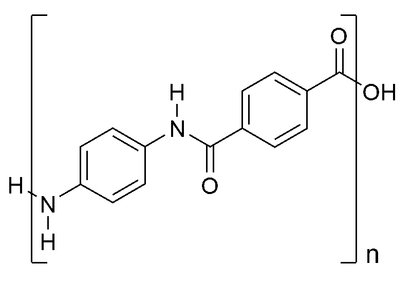

## Examples of Polyamides

- Synthetic polyamides: nylons and Kevlar

- Natural polyamides: proteins

**Nylon 6, 6**

- Monomers:

‎

(Hexandioic acid 1, and 6-diaminohexane)

- Polymer:

‎

**Properties of Nylon:**

- High tensile strength: due to strong H-bonds between chains of polymers (the N and O atoms with H)

- Elasticity: single covalent bonds within polymer, chains are free to
  rotate

- Low density: unbranched chains, no gaps

Hence, nylon is a very useful fibre in the clothing industry, as well as for climbing-ropes

**Kevlar:**

- Monomers:

‎

1,4-diaminobenzene, and benzene-1,4-dicarboxylic acid                                                            
(benzene-1,4-dioyl chloride can be used instead of the acid)

- Polymer:

- Extremely strong: delocalization of $\pi$ e-s beyond
  benzene ring on to amide link, enhanced intermolecular bonding
  between polymer chains

- Flexible, fire resistant and low density

- Hydrogen bonding between chains:

