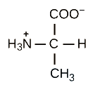
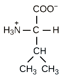
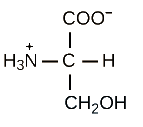
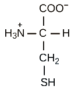
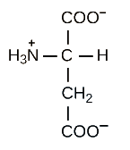
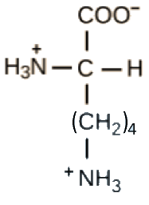

## Proteins 

  - Proteins: a natural polyamide; many polypeptide chains held together
    by intermolecular forces

  - Amino acid residue: an amino acid unit within a polypeptide chain

&nbsp;

**Examples of Amino Acids:**

<table>
<thead>
<tr class="header">
<th colspan=2><strong>Non-Polar R-Group:</strong></th>
<td></td>
<th colspan=2><strong>Polar R-Group:</strong></th>
</tr>
</thead>
<tbody>
<tr class="odd">
<td>
‎

<strong>alanine</strong>
</td>
<td>
‎

<strong>valine</strong>
</td>
<td></td>
<td>
‎

<strong>serine</strong>
</td>
<td>
‎

<strong>cysteine</strong>
</td>
</tr>
<tr class="even">
<td colspan=5><strong>Electrically Charged R-Group:</strong></td>
</tr>
<tr class="odd">
<td colspan=2>
‎

<strong>aspartic acid</strong>
</td>
<td colspan=3>
‎

<strong>lysine</strong>
</td>
</tr>
</tbody>
</table>png" width=70%>
