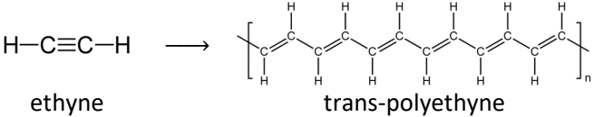

## Conducting Polymers

  - Polymers generally insulators but ethyne can conduct electricity

‎

  - Contains alternate single & double carbon-carbon bonds

  - Can conduct electricity because p-orbitals on neighbouring carbon
    atoms overlap resulting in long bands of delocalized $\pi$
    e-s free to move along the chain

  - Doping: other substances, such as iodine, added to improve
    electrical conductivity of polymer

  - Advantages over metal conductors:
    
      - Do not corrode
    
      - Much less dense
    
      - Shaped more easily

  - E.g. made into thin sheets to make flat panels that light
