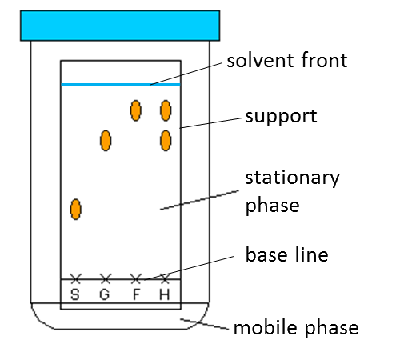

# Analytical Techniques

## Paper Chromatography

  - **Mobile phase:** solvent in the chromatography process, which moves
    through the paper or thin layer

  - **Stationary phase:** immobile phase in chromatography that the
    mobile phase passes over or through

  - As the solute rises with the solvent, they get separated by
    partition from mobile phase to the stationary phase

<!-- end list -->

  - Depending on solubility, the solutes migrate at different rates and
    travel up to different distances

  - **Partition:** separation due to different solubilities of compound
    in two solvents

  - The more polar a solute component is, the less it travels as there
    are stronger H-bonds to H2O of st. phase

  - **Identifying components:**
    
      - Compare position/colour on filter paper with those of known pure
        compounds
    
      - Find and compare the Rf value

  - **Rf value:** ratio of the distance a component has
    travelled compared with distance travelled by the solvent front

  - When using Rf values to identify a substance, conditions
    in which chromatography is carried out must be identical to those
    quoted in Rf data table (e.g. temp, solvent)

$$R_f = \frac{\text{Distance Moved by Solute Spot}}{\text{Distance Moved by Solvent Front}}$$

  - Colourless chromatograms can be seen by spraying a locating agent
    (e.g. ninhydrin) to reveal spots
