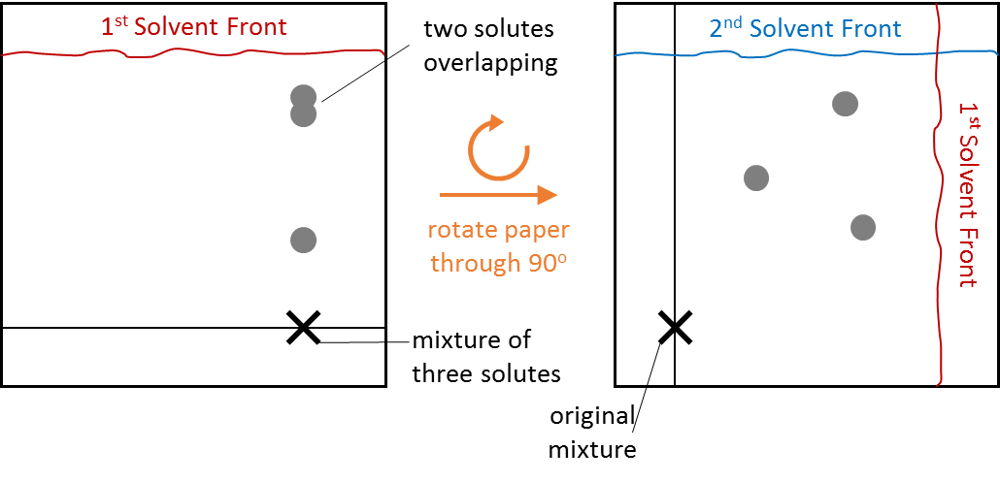

## Two-way Chromatography

  - When two or more components in a mixture have similar Rf
    values in a particular solvent, chromatography can be carried out
    again by rotating the chromatogram 90o and re-running in
    a different solvent

