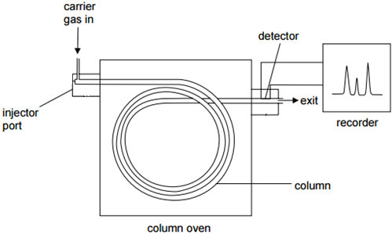
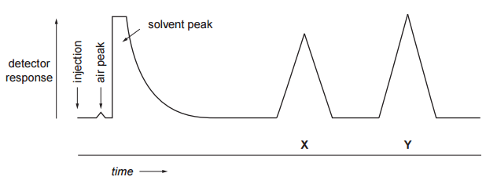

## Gas/Liquid Chromatography

* Used to separate and identify very small samples of gases, liquid
  and volatile solids

* The vaporized sample is carried by an inert gas (mobile phase) over
  the surface of a liquid (stationary phase)
* When stationary phase is **non-polar**, rate of movement is
  determined principally by volatility
* When stationary phase is **polar**, it will tend to retain polar
  components of the mixture
* Components of a mixture leave the column after definite intervals of
  time and are monitored by a detector designed to record changes in
  composition of carrier gas
* **Retention time:** time it takes components to reach the detector
  from time of injection
* **Determination of % composition of a mixture by GLC:**
  * Peaks are roughly triangular in shape so area is:

$$\frac{1}{2} \times base \times height$$

‎ 

*e.g. % of X*
$= \frac{\text{Peak Area of X}}{\text{Sum of Areas of X and Y}}$

| Technique | Separation Method |
|----|----|
| Paper chromatography | 
Partition
 |
| Thin-layer chromatography | 
Adsorption
 |
| Gas/liquid chromatography | 
Partition
 |