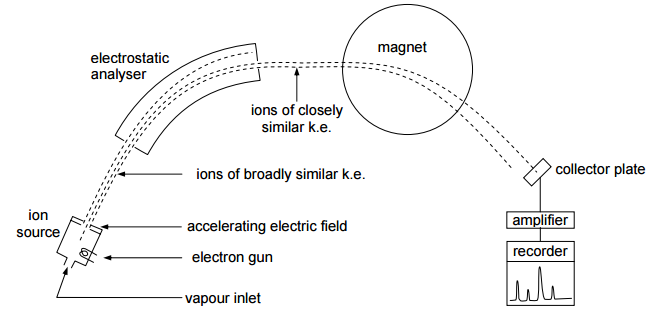

## Mass Spectrometry

**The mass spectrometer:**

  - A vaporized sample is injected through the vapor inlet

  - The sample is ionized to form positive ions

  - The positive ions are accelerated by an electric field

  - Accelerated positive ions are deflected by magnetic field

  - Positive ions of a particular mass/charge ratio are detected –
    recorded as a series of peaks: mass spectrum

  - **Molecular ion (M+):** the peak at the highest mass to
    charge ratio; gives relative molecular mass of sample

  - **Base peak:** peak in a mass spectrum that corresponds to the most
    abundant fragment

  - During bombardment, some energy is transferred to the ion, weakening
    the bonds and breaking molecular ion into fragment +ve ions &
    radicals; only +ve ions detected

  - **Fragmentation:** the breaking up of a molecule into smaller parts
    by the breaking of covalent bonds
