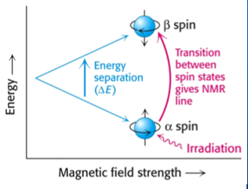

## Proton (1H) NMR Spectroscopy 

‎

  - The hydrogen nucleus behaves as a tiny magnet.

  - These "magnets" can align themselves with or against an applied
    magnetic field

  - There is an energy gap between these two alignments, which
    corresponds to the energy in radio frequencies.

  - The size of energy gap between the two alignments depends on the
    other atoms in the molecule around it – molecular environment

  - TMS, Si(CH3)4 is used as standard because:
    
      - It is an inert volatile liquid
    
      - Most organic compounds are soluble in it
    
      - Contains 12 H atoms in the same environment which produces a
        single, strong peak

  - NMR must be carried out in solution
    
      - CCl4 can be used as a solvent as it has no H & inert
    
      - CDCl3 (deuterated solvents) can also be used because
        signal produced by D does not lie in spectrum area of H

  - The horizontal scale of magnetic field is measured in units called
    chemical shift $\delta$ (ppm)

  - TMS is considered as 0 and all other compounds are compared by
    quoting shift away from TMS line

  - **Low Resolution NMR:**
    
      - Shows single peaks for each non-equivalent H-atoms
    
      - Relative peak areas proportional to no. of H-atoms
    
      - Can use shift value to identify type of H-atom present

  - **High Resolution NMR:**
    
      - The NMR signal is also affected by magnetic field of H-atoms on
        neighbouring C atoms
    
      - Causes peaks to split in particular patterns due to spin-spin
        splitting