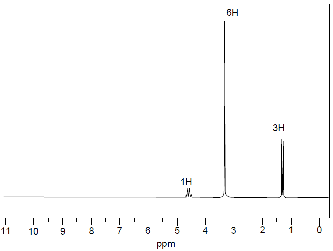

## Describing an NMR Spectra

For example:

  - To identify the protons present, set up a table as follows

| No. of H | Chemical shift | Type of proton      | Splitting pattern | No. of H on adj. C |
| -------- | -------------- | ------------------- | ----------------- | ------------------ |
| 3        | 1.30           | \-CH3    | Doublet           | 1                  |
| 6        | 3.30           | \-O-CH3  | Singlet           | 0                  |
| 1        | 4.60           | \-O-CHR2 | Quartet           | 3                  |

  - Final molecule: (CH3O)2CH-CH3
