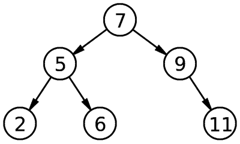
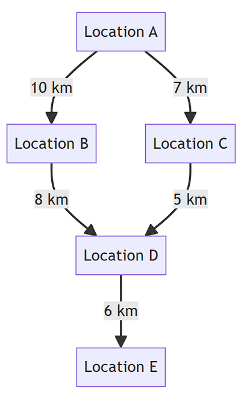

## Abstract Data Types (ADTs)

A collection of data with associated operations like a stack, queue, linked list, binary tree and graphs.

### Binary Tree




|Index|Left Pointer|Data|Right Pointer|
|:---|:---|:---|:---|
|0|1|7|2|
|1|3|5|4|
|2|Ø|9|5|
|3|Ø|2|Ø|
|4|Ø|6|Ø|
|5|Ø|11|Ø|

- Each parent node contains the data being stored and has 0-2 children.
- Upper most node is referred to as the root.
- A node with no children is called a leaf.
- A node with children is called a branch.
- When traversing, start at the root. When the target is lesser than the current value we move left and vice versa.
- Ø is used as the null pointer.

#### Creation (Pseudocode)

```ts
TYPE Node
	DECLARE Left: INTEGER
	DECLARE Data: INTEGER
	DECLARE Right: INTEGER
ENDTYPE
DECLARE Tree Array[0:5] OF Node 
CONSTANT NullPtr = -1 // 1 less than the lower bound of the array
// Initializing a tree
FreePtr ← 0 // Starting position of free list
RootPtr ← NullPtr // Always points to the root of the tree
FOR I ← 0 TO 4 // Links all nodes 
	Tree[I].Left ← I + 1
	Tree[I].Right ← NullPtr
NEXT I
Tree[5].Left ← Null
```

#### Adding an Item (Pseudocode)

```ts
Data ← // Some value
IF FreePtr != NullPtr THEN
	NewNodePtr ← FreePtr
	FreePtr = Tree[FreePtr].Left
	Tree[NewNodePtr].Data = Data
	Tree[NewNodePtr].Left = NullPtr
	IF RootPtr = NullPtr THEN // If there is no root node, then make this the root node
		RootPtr = NewNodePtr
	ELSE
		CurrentPtr ← RootPtr // Starts at root
		PreviousPtr ← CurrentPtr
		WHILE CurrentPtr != NullPtr // Search, starting at the root, and find where to insert node
			PreviousPtr ← CurrentPtr
			IF Tree[CurrentPtr].Data > Data THEN
				TurnedLeft ← FALSE
				CurrentPtr = Tree[CurrentPtr].Left
			ELSE
				TurnedLeft = FALSE
				CurrentPtr = Tree[CurrentPtr].Right
			ENDIF
			IF TurnedLeft = TRUE THEN
				Tree[PreviousPtr].Left = NewNodePtr
			ELSE
				Tree[PreviousPtr].Right = NewNodePtr
			ENDIF
		ENDWHILE
	ENDIF
ELSE
	OUTPUT "Tree is full"
ENDIF
```

#### Finding an Item (Pseudocode)

```ts
Target ← // Some value
CurrentPtr ← RootPtr
WHILE CurrentPtr != NullPtr
	IF Tree[CurrentPtr].Data == Target THEN
		OUTPUT "Found at ", CurrentPtr 
	ELSE IF Tree[CurrentPtr].Data < Target THEN
		CurrentPtr = Tree[CurrentPtr].Left
	ELSE
		CurrentPtr = Tree[CurrentPtr].Right
	ENDIF
ENDWHILE
```

### Linked List

A linked list contains a node that points to the next node and the data value.

### Creation (Pseudocode)

```ts
TYPE Node
	DECLARE Data: INTEGER
	DECLARE Next: INTEGER
ENDTYPE
DECLARE List Array[0:5] OF Node 
CONSTANT NullPtr = -1 // 1 less than the lower bound of the array
// Initializing a linked list
FreePtr ← 0 // Starting position of free list
StartPtr ← NullPtr // Starting positon of list
FOR I ← 0 TO 4 // Links all nodes 
	List[I].Next ← I + 1
NEXT I
List[5].Next ← Null
```

### Adding an Item (Pseudocode)

```ts
Data ← // Some value
IF FreePtr != NullPtr THEN
	NewNodePtr ← FreePtr
	FreePtr = List[FreePtr].Next
	List[NewNodePtr].Data = Data
	CurrentPtr ← StartPtr
	PreviousPtr ← NullPtr
	WHILE CurrentPtr != NullPtr AND List[CurrentPtr].Data < Data
		PreviosuPtr = CurrentPtr
		CurrentPtr = List[CurrentPtr].Next
	ENDWHILE
	IF PreviousPtr = NullPtr THEN
		List[NewNodePtr].Next ← StartPtr
		StartPtr = NewNodePtr
	ELSE
		List[NewNodePtr].Next = List[PreviousPtr].Next
		List[PreviousPtr].Next = NewNodePtr
	ENDIF
ELSE
	OUTPUT "List is full"
ENDIF
```

### Finding an Item (Pseudocode)

```ts
Target ← // Some value
CurrentPtr ← StartPtr
Found ← FALSE
WHILE CurrentPtr != NullPtr AND NOT Found
	IF List[CurrentPtr].Data == Target THEN
		OUTPUT "Found at ", CurrentPtr
		Found = TRUE 
	ELSE
		CurrentPtr = List[CurrentPtr].Next
	ENDIF
ENDWHILE
```

### Deleting an Item (Pseudocode)

```ts
Target ← // Some value
CurrentPtr ← StartPtr
PreviousPtr ← NullPtr
WHILE CurrentPtr != NullPtr AND List[CurrentPtr] != Target
	PreviousPtr = CurrentPtr
	CurrentPtr = List[CurrentPtr].Next
ENDWHILE
IF CurrentPtr = NullPtr THEN
	OUTPUT Target, " does not exist"
ELSE
	IF CurrentPtr = StartPtr THEN
		StartPtr = List[StartPtr].Next
	ELSE
		List[PreviousPtr].Next = List[CurrentPtr].Next
	ENDIF
	List[CurrentPtr].Next = FreePtr
	FreePtr = CurrentPtr
ENDIF
```

### Queue

- Each element in a queue stores one data item
- Pointer for the front and the back of the queue.
- Works on the principles of “First in first out”.
- Has two accessible ends.

### Creation (Pseudocode)

```ts
CONSTANT NullPtr = -1 // 1 less than the lower bound of the array
CONSTANT MaxSize = 8
DECLARE Queue Array[0:MaxSize-1] OF String
DECLARE FrontPtr : INTEGER
DECLARE EndPtr : INTEGER
DECLARE Size : INTEGER
// Initializing a queue
PROCEDURE InitialiseQueue()
	FrontPtr ← NullPtr
	EndPtr ← NullPtr
	Size ← 0
ENDPROCEDURE 
```

### Adding an Item (Pseudocode)

```ts
PROCEDURE Enqueue(Data)
	IF Size >= MaxSize THEN
		OUTPUT "Queue overflow"
	ELSE
		EndPtr = EndPtr + 1
		IF EndPtr > MaxSize - 1 THEN
			EndPtr = 0 // Go back to the start
		ENDIF
		Queue[EndPtr] = Data // Add item
		Size = Size + 1
	ENDIF
ENDPROCEDURE
```

### Deleting an Item (Pseudocode)

```ts
FUNCTION Dequeue() RETURNS String
	DECLARE Item : String
		IF Size <= 0 THEN
			OUTPUT "Queue underflow"
		ELSE
			Size = Size - 1
			Item = Queue[FrontPtr] // Get item
			IF Size == 0 THEN
				CALL InitialiseQueue()
			ELSE
				FrontPtr = FrontPtr + 1
				IF FrontPtr > MaxSize - 1 THEN
					FrontPtr = 0 // Go back to start
				ENDIF
			ENDIF
		ENDIF
	RETURN Item
ENDFUNCTION
```

### Stack

- Each element stores one data item.
- Pointer to the current place of the stack.
- Stores elements on the principles of “First in last out”.
- Has one accessible end.
- Use cases include: recursion, interrupt handling, evaluation of RPN expressions and implementing ADTs

### Creation (Pseudocode)

```ts
CONSTANT NullPtr = -1 // 1 less than the lower bound of the array
CONSTANT MaxSize = 8
DECLARE Stack Array[0:MaxSize-1] OF String
DECLARE Ptr : INTEGER
// Initializing a stack
PROCEDURE InitialiseStack()
	Ptr ← NullPtr
ENDPROCEDURE 
```

### Adding an Item (Pseudocode)

```ts
PROCEDURE Push(Data)
	IF Ptr >= MaxSize - 1 THEN
		OUTPUT "Stack overflow"
	ELSE
		Ptr = Ptr + 1
		Stack[Ptr] = Data
	ENDIF
ENDPROCEDURE
```

### Deleting an Item (Pseudocode)

```ts
FUNCTION Pop() RETURNS String
	DECLARE Item : String
		IF Ptr <= NullPtr THEN
			OUTPUT "Stack underflow"
		ELSE
			Item = Stack[Ptr]
			Ptr = Ptr - 1
		ENDIF
	RETURN Item
ENDFUNCTION
```

### Graph

- A structure used to model relationships between objects.
- Consists of nodes and edges.
- Can be bidirectional or unidirectional.
- An example use for a graph includes google maps. Each location is represented by a node. The edges represent the routes between the nodes.

