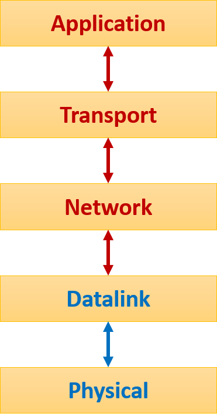

# Communication and Internet Technologies

## Protocols

A protocol sets the rules of the communication. Protocols allows for devices to communicate across different platforms. If two devices attempted to communicate while using different protocols, the communication would fail. TCP/IP is the dominant protocol suite for internet usage.

### TCP/IP Suite

- A layered model (stack) with 4 layers; Application. transport, internet and data link. The Suite uses a set of protocols for the transmission of data in these layers like TCP (Transport Control Protocol) and IP (Internet Protocol).
- TCP maintains connection between two nodes and ensures delivery of data between the two nodes.
- IP provides rules of exchange for packets and decides the route for sending packets.

**Application Layer:**

- The application layer provides user services.
- Encodes data in an appropriate format when sending a message
- Performs the action requested by the user when receiving a message

**There are the main types of protocols:**

* **HTTP and HTTPS (Hypertext Transfer Protocol):** Used to transfer webpages from server to client. HTTPS is more secure.

* **FTP (File Transfer Protocol):** Used for sending and receiving files over the network between two devices.

* **POP3 (Post Office Protocol):** Used for receiving emails.

* **IMAP (Internet Message Access Protocol):** Also used for receiving emails. The email client retrieves the emails from the mail server.

* **SMTP (Simple Mail Transfer Protocol):** Used for sending emails

**Transport Layer:**

- Handles packets.
- Converts the data received from the application layer into individual packets when sending a message.
- Adds packet headers and then sends these packets to the internet layer.
- Controls the flows of packets and handles packet loss or corruption.
- When receiving a message, it reads the header and determines which application layer the data must be sent to, then strips the header and forwards it

**Internet Layer:**

- Handles the transmission of data using IP addresses.
- Identifies the intended network and host and then transmits the packets through the data link layer.
- Routes each packet independently through the best route available
- IP Addresses, of the sender and receiver, and checksum are added when sending messages
- When receiving a message it reassembles the fragments, strips the IP header and sends it to the transport layer

**(Data) Link Layer:**

- Converts the electrical data into analog signals and sends it, allowing the upper layers access to the physical medium.
- Formats data into frames for transmission and maps IP addresses to MAC (hardware) addresses.
- Ensures correct network protocols are followed.
- Verifies the checksum when receiving a message and then sends it to the internet layer

### Peer-to-peer File Sharing

- BitTorrent uses Peer-To-Peer file sharing model.
- A BitTorrent client software is made available to the public.
- **Swarm:** All connected peer computers that have all or parts of file being downloaded/uploaded.
- **Tracker:** A central server that stores information on which computers have which files and which parts of those files. It also shares the IP addresses of computers to allow them to connect to each other.
- **Seed:** is the peer computer that uploads the file that is being downloaded.

If a user wishes to join this network, they need to use a BitTorrent client to load the torrent descriptor file. When a user wishes to download a file, pieces of this file are downloaded and uploaded at the same time. When a user has even a single piece of a file they become a seed. To be able to download this file, a complete copy needs to exist on one of the peer computers.