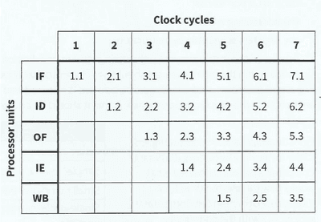

# Hardware and Virtual Machines

## RISC & CISC Processors

* **RISC:** Reduced Instruction Set Computers.
* **CISC:** Complex Instruction Set Computers.

|**RISC**|**CISC**|
|:---|:---|
|Fewer instructions|More instructions|
|Simpler instructions|Complicated instructions|
|A small number of instruction formats|Many instruction formats|
|Single-cycle instructions whenever possible|Multi-cycle instructions|
|Fixed-length instructions|Variable-length instructions|
|Only load and store instructions to address memory|Many types of instructions to address memory|
|Fewer addressing modes|More addressing modes|
|Multiple register sets|Fewer registers|
|Hard-wired control unit|Microprogrammed control unit|
|Pipelining easier|Pipelining much difficult|

* **Pipelining:** Instruction level parallelism
  * Used extensively in RISC processor-based systems to reduce the time taken to run processes
  * Multiple registers are employed
* **Interrupt handling in CISC and RISC Processors:**
  * As soon as the interrupt is detected, the current processes are paused and moved into registers
  * The ISR (Interrupt Service Routine) is loaded onto the pipeline and is executed.
* When the interrupt has been serviced, the paused processes are
  resumed by bringing them back from the registers to the pipeline
* RISC processors allow for providing efficient pipelining. Pipelining is instruction-level parallelism. Its underlying principle is that the fetch-decode execute cycle can be separated into several stages.

One of the possibilities include:

1. Instruction fetch (IF)
2. Instruction decode (ID)
3. Operand fetch (OF)
4. Instruction execution (IE)
5. Result write back (WB)

### **Pipelining for Five-Stage Instruction Handling** 

* For pipelining to be implemented, the construction of the processor must have five independent units, each handling one of the five identified stages.

* Therefore, it's important for RISC processors to have many register sets. Each processor unit must have access to its own set of registers. The representations 1.1, 1.2, and so on are used to define the instruction and the stage of the instruction. Initially, only the first stage of the first instruction has entered the pipeline. At clock cycle 6, the first instruction has left the pipeline, the last stage of instruction 2 is being handled, and instruction 6 has just been entered. Once underway, the pipeline is handling 5 stages of 5 individual instructions. At each clock cycle, the complete processing of one instruction is finished. Without the pipelining, the processing time would've been 5 times longer.

* One disadvantage is interrupt handling. There will be 5 instructions in the pipeline when an interrupt occurs, so it needs to remove those previous instructions and then handle the interrupt.