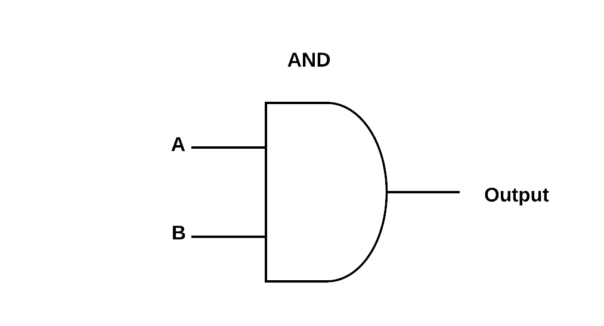
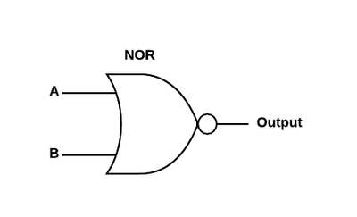
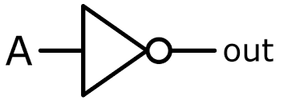
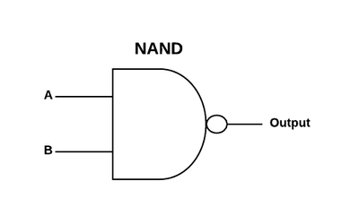
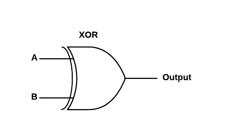
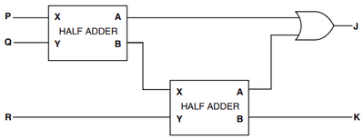
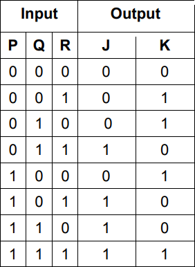

## Logic Gates & Circuit Design

**Logic Gates:** A component of a logical circuit that can perform a Boolean operation

* **AND Gate:** $A.B\  = \ X$

|**A**|**B**|**X**|
|:---|:---|:---|
|0|0|0|
|0|1|0|
|1|0|0|
|1|1|1|

* **OR Gate:** $A + B = X$

|**A**|**B**|**Output**|
|:---|:---|:---|
|0|0|0|
|0|1|1|
|1|0|1|
|1|1|1|

* **NOT Gate:** $\overline{A}\  = \ X$

  

|**A**|**Output**|
|:---|:---|
|0|1|
|1|0|

* **NAND Gate:** $\overline{A.B}\  = \ X$

|**A**|**B**|**Output**|
|:---|:---|:---|
|0|0|1|
|0|1|1|
|1|0|1|
|1|1|0|

* **NOR Gate:** $\overline{A + B} = X$

|**A**|**B**|**Output**|
|:---|:---|:---|
|0|0|1|
|0|1|0|
|1|0|0|
|1|1|0|

* **XOR Gate:** $A.\overline{B} + \overline{A}.B = X$

|**A**|**B**|**Output**|
|:---|:---|:---|
|0|0|0|
|0|1|1|
|1|0|1|
|1|1|0|

### Half-Adder

- A half adder adds two binary digits and outputs the sum (s) and their carry (c).

- A XOR gate acts like a half adder.

  <table>
  <thead>
  <tr>
  <th colspan=2><strong>Input</strong></th>
  <th colspan=2><strong>Output</strong></th>
  </tr>
  </thead>
  <tbody>
  <tr>
  <td><strong>A</strong></td>
  <td><strong>B</strong></td>
  <td><strong>S</strong></td>
  <td><strong>C</strong></td>
  </tr>
  <tr>
  <td>0</td>
  <td>0</td>
  <td>0</td>
  <td>0</td>
  </tr>
  <tr>
  <td>0</td>
  <td>1</td>
  <td>1</td>
  <td>0</td>
  </tr>
  <tr>
  <td>1</td>
  <td>0</td>
  <td>1</td>
  <td>0</td>
  </tr>
  <tr>
  <td>1</td>
  <td>1</td>
  <td>0</td>
  <td>1</td>
  </tr>
  </tbody>
  </table></td>
  </tr>
  </table>

  ### Full-Adder

  A full adder adds three binary digits and outputs the sum and their carry.

  

  - R is "Carry In"
  - J is "Carry Out"
  - K is "Sum"

  