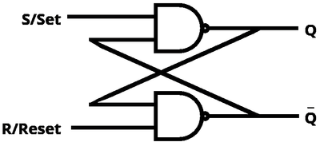
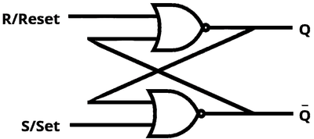
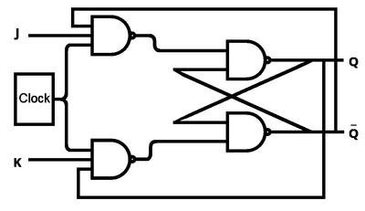

## Flip-Flops

* Flip flops can store a single bit of data as 0 or 1
* Computers use bits to store data.
* Flip-flops can be used to store bits of data.
* Memory can be created from flip-flops.

### **SR Flip Flops**

- Can be made with NAND gates or NOR gates
- Error state exists

|**S**|**R**|**Q**|**Q Bar**|
|:---|:---|:---|:---|
|0|0|1|1|
|0|1|1|0|
|1|0|0|1|
|1|1|No Change|No Change|

* 00 causes an error as Q Bar is no longer the complement of Q

* 01 sets Q to 1

* 10 resets Q to 0

* 11 leads to no change; the initial value remains

|**S**|**R**|**Q**|**Q Bar**|
|:---|:---|:---|:---|
|0|0|No Change|No Change|
|0|1|0|1|
|1|0|1|0|
|1|1|0|0|

* 11 causes an error as Q Bar is no longer the complement of Q

* 10 sets Q to 1

* 01 resets Q to 0

* 00 leads to no change; the initial value remains

### **JK Flip Flops**

* JK flip flops are only active when the clock is high.
* JK flip flops use a clock pulse for synchronization to ensure proper functioning.
* Advantages of JK flip flops include the validity of all input combinations, avoidance of unstable states, and increased stability compared to SR flip flops.

|**Clock**|**J**|**K**|**Q**|**Q Bar**|
|:---|:---|:---|:---|:---|
|0|0|0|-|-|
|0|0|1|-|-|
|0|1|0|-|-|
|0|1|0|1|1|
|1|0|0|No Change|No Change|
|1|0|1|0|1|
|1|1|0|1|0|
|1|1|1|1|1|
