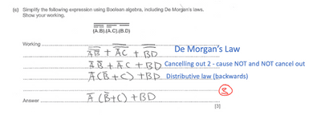

## Boolean Algebra

* **Double Complement:** $\overline{\overline{A}} = A$
* **Identity Law**
  * $1.A\  = \ A$
  * $0 + A\  = \ A$
* **Null Law**
  * $0.A\  = 0$
  * $1 + A\  = \ 1$
* **Idempotent Law**
  * $A.A\  = \ A$
  * $A + A = A$
* **Inverse Law**
  * $A.\overline{A} = 0$
  * $A + \overline{A}\  = \ 1$
* **Commutative Law**
  * $A.B\  = \ B.A$
  * $A + B\  = \ B + A$
* **Associative**
  * $(A.B).C\  = \ A.(B.C)$
  * $(A + B) + C\  = \ A + (B + C)$
* **Distributive Law**
  * $A + B.C\  = \ (A + B).(A + C)$
  * $A.\left( B + C \right) = A.B + A.C$
* **Absorption Law** 
  *  $A.\left( A + B \right) = A$
  * $A + A.B = A$
* **De Morgan’s Law**
  * $(\overline{A.B})\  = \ \overline{A}\  + \ \overline{B}$
  * $\left( \overline{A + B} \right) = \overline{A}.\overline{B}$

**{example}**

