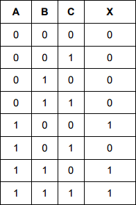
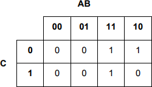
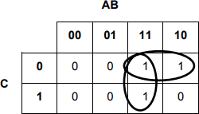

## Karnaugh Maps

* **Karnaugh maps:** a method of obtaining a simplified Boolean algebra expression from a truth table. They minimize the number of logic circuits, thus making it more efficient.
* **Sum of products:** all the combinations that lead to 1 in the output.

### Methodology

* Try to look for trends in the output, thus predicting the presence of a term in the final expression
* Draw out a Karnaugh Map by filling in the truth table values into the table
* Select groups of ‘1’ bits in even quantities (2, 4, 6, etc.); if not possible, then consider a single input as a group
* Note: Karnaugh Maps wrap around columns
* Within each group, only the values that remain constant are retained

### Example

1. Sum of Products

   $A\cdot \overline{B} \cdot \overline{C} + A \cdot B \cdot \overline{C} + A \cdot B \cdot C$

2. Fill in the map

3. Circle the largest group containing an even number of 1s.

4. Take the common values from both

   - In the first group, $A\cdot B$ is common
   - In the second group, $A\cdot \overline{C}$ is common

5. Write the simplified expression.

   $A \cdot \overline{C} + A \cdot B$