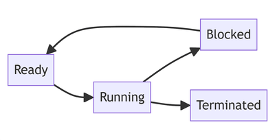

## Process Scheduling

The process of allocating the CPU’s time on different processes based on their needs.

### Importance

- Allows for multi-tasking to take place
- Ensures the CPU is busy at all times
- Makes sure that all programs have fair access to the CPU so that they can be executed efficiently.
- Prevents starvation

### Process States

- **Ready:** The process is not currently being executed. It is in the queue waiting for the processor’s attention.
- **Running:** The process is being executed and currently has the processor’s attention.
- **Blocked:** The process is waiting for an event before it can continue running like a user input.
- **Terminated:** The process has finished execution and has been removed from the queue.

### Scheduling Algorithms

- **Shortest Job First:** Processes are executed in ascending order based on the time needed to execute the task with smaller jobs being executed first. This allows the CPU to execute more processes in a smaller amount of time. This is non-preemptive.
- **Round Robin:** Each process is allocated a specific amount of time from the CPU. Their execution takes place within these time frames. This helps prevent starvation.
- **First Come First Served:** No complex logic involved; processes are executed in the order they are requested. There is less processor overhead due to its simplicity.
- **Shortest Remaining Time:** Processes are executed in order of shortest remaining time for execution. It ensures there is smaller waiting times between process execution. This is preemptive.

### Interrupt Handling

When an interrupt occurs, the process in the running state is moved to the ready state and the interrupt is moved to the running state so that it may be serviced.

**Low Level Scheduler:** Decides which of the processes in the ready state should be moved to the running state based on their priority/position.

**High Level Scheduler:** Decides which of the processes should be loaded from the backing store into the ready state.