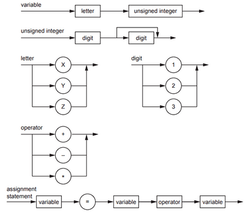

## Backus-Naur Form (BNF) Notation

A form of expressing the grammar of a language visually.

### Example



```js
<variable> ::= <letter> <usigned integer>;

<usigned integer> ::= <digit> | <digit> <digit>;

<letter> ::= X | Y | Z;

<digit> ::= 1 | 2 | 3;

<operator> ::= + | - | *;

<assignment statement> ::== <variable> = <variable> <operator> <variable>;

```

**Notations**

< >         : used to enclose an item\
\:: ==       : separates an item from its definition\
\|             : between items, indicates a choice\
;             : the end of each rule.