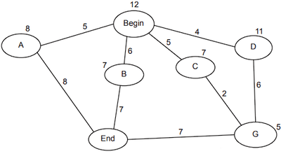

# Artificial Intelligence (AI)

## Graphs

A graph is an abstract datatype that contains a collection of nodes. These nodes are connected to each other with edges. A node usually has a name, and an edge usually has a numerical value.

One example of graphs is A* or Dijkstra's algorithm. The nodes represent locations, and the edges represent the distance between them.

### Use of Graphs

- Graphs provide relationships between different nodes.
- Allows AI problem to be defined as the most efficient route between two nodes
- Analyzed by machine learning algorithms such as A* to perform calculations
- Graphs can also be used to represent neural networks.