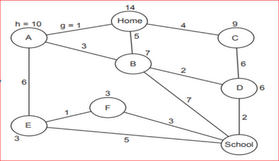
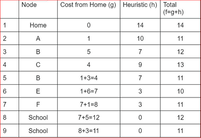

## A* & Dijkstra’s Algorithm

These algorithms are used to find the shortest route between two nodes based on the distance.

### *How to Implement A* Algorithm?

Below is an example of the implementation of the A* Algorithm:

* h is the heuristic value
* g is the movement cost
* F is the sum of g and h values.

* Start from the Home. The cost from Home to Home is 0, so g= 0. The heuristic cost of a home is 14, so h=14 and f=g+h=14.
* Now, there are three immediate nodes from home: A, B, and C. Calculate the values of g, h and f  for A, B and C from home and write them in the table.
* Select the node whose f value is the shortest (in this case, Node A).
* From A, there are two immediate nodes, B and E. Calculate the g value for each node and add the g value of A. Then, add the corresponding h values to get f for each node.
* From E, there are two immediate nodes, School and F. Calculate the g value for each node and add the g value of E. Then, add the corresponding h values to get f for each node.
* From F to School, add the g value (3) to the g value of F (8) and calculate f.

Final path = Home → A→E→F→School.

