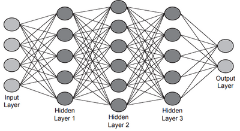

## Neural Networks & Machine Learning

### Neural Networks

- Neural networks are modelled on the human brain.
- They contain input and output nodes as well as one or more hidden layers.
- Each input node is assigned a specific weight, these weights are summed, and an activation function calculates a value for the output.
- Repeated for each layer within the network thereby allowing reinforcement learning to take place.

**Use of Hidden Layers:**

- Allow deep learning to take place
- Allows the network to make decisions independently
- Helps to improve the accuracy of the output

### Machine Learning

Machine learning is a field of artificial intelligence in which computers learn from provided data and past experiences in order to improve its performance in a given task without explicitly being programmed to know how to do the task.
For example, rather than telling the computer that emails that advertise free products are most likely scams we feed it a lot of data and it identifies that pattern on its own.

### Deep Learning

A subset of machine learning that simulates the decision making and data processing abilities of the human brain.

**Benefits:**

- Good with extremely large sets of data
- Good with unstructured data
- Can identify hidden patterns

### Reinforcement Learning

Reinforcement learning allows the computers to make decisions that maximize the reward, it is then graded based on how well it performed. Over time the computer learns the correct decisions it needs to make based on its past experiences.

### Supervised Learning

In supervised learning the computer is fed labelled test data, and it identifies the patterns that led to the data being labelled in a specific way. This allows it to then predict labels for new unseen data.

### Unsupervised Learning

In unsupervised learning the computer is fed unlabeled test data, and it identifies hidden patterns.

### Back Propagation of Errors

An algorithm identifies errors with the machine learning and is then used to adjust the model for improved accuracy by starting at the output layer and working backwards through the hidden layers to the input layer.

For example, if you threw a ball and missed your target. You'd check how far off you were from the target and then adjust things like angle and strength the next time you threw the ball.

### Regression

Regression is finding a mathematical function that best fits output data based on the previous results in order to predict the future value.