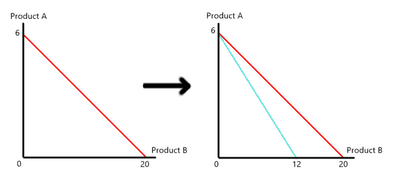

## Budget Line, Substitution Effect and Income Effect

- **Budget Line:** The combination of two products obtainable with given income and prices.
- **Substitution Effect:** Following a price change, a consumer will substitute the more expensive product for the one that is now relatively cheaper.

  

- **Income Effect:** The resultant change in demand for a good or service caused by an increase or decrease in a consumer's purchasing power or real income.
  - The income effect has a positive relationship with normal goods, meaning if income increases, consumers can **purchase more of the normal goods.
  - The income effect has an inverse relationship with inferior goods, meaning if income increases, consumers will purchase less of the inferior goods.
  - These cause a shift in the budget line:
    - A rightward shift for normal goods.
    - A leftward shift for inferior goods.
