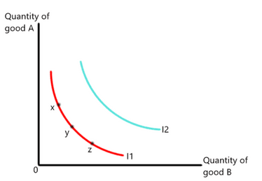
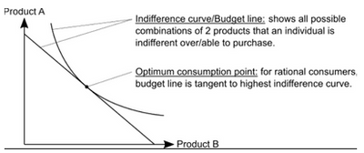
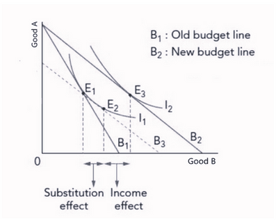
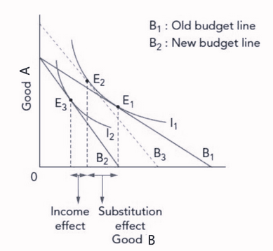
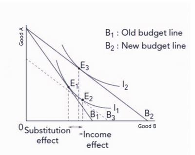

## Indifference Curve

- **Indifference Curve:** This shows the different combinations of two goods that give consumers equal satisfaction. It represents the extent to which consumers are willing to substitute one good for another.
- **Marginal Rate of Substitution:** The rate at which a consumer is willing to substitute a good for another. This affects the slope of the curve.
 

- Consumers are indifferent to **x, y, and z** since they are all on the same curve. The equimarginal principle is applied here.
- A higher indifference curve (I2) indicates a higher level of consumption and utility. The higher the curve placement, the **more preferable**.

- The budget line represents the **extent of consumer income**, and the indifference curve indicates the **extent of available consumer choices**. Together, they show how consumers can **maximize satisfaction**.
- A consumer’s choice is **optimal** at the point where the budget line is tangent to the highest indifference curve. This point shows the **marginal rate of substitution**.

- Following a **price decrease for Normal Good B**, a price decrease for Good B increases the consumer's purchasing power (they can now buy more).
  - A shift from **consumer equilibrium, E1 to E2,** is the **substitution effect**. Consumers will now purchase more of Good B as it is relatively cheaper than Good A.
  - A shift from **consumer equilibrium, E2 to E3,** is the **income effect**. With more purchasing power, the **budget line shifts to B2**, allowing more of Good B to be purchased while keeping Good A constant.

- **Summary of Effects:**
  - Substitution effect: E1 to E2, a shift in the budget line causing movement along the indifference curve.
  - Income effect: E2 to E3, a shift to a new indifference curve.
  - **Price Effect = Substitution Effect + Income Effect.**

- Example: An **increase in the price of Normal Good B**.
  - Substitution effect: E1 to E2. Consumers switch to buying more of Good A.
  - Income effect: E2 to E3. Reduced purchasing power negatively affects consumption of both goods.

- For **inferior goods**, an increase in purchasing power results in less consumption of Good B (consumers favor more expensive goods). This creates a **negative income effect**, which may not fully offset the substitution effect.

- **Giffen Goods** are a sub-category of inferior goods, where consumption increases as price increases. This is due to a strong income effect:
- When the price of a Giffen good increases (e.g., staple food like rice), the **substitution effect is negative** (budget decreases), but the **strong positive income effect** dominates.

### Price Effects Table

| **Price Change** | **Good Type** | **Price Effect (on demand)** | **Demand Change** |
|-------------------|---------------|------------------------------|--------------------|
| **Fall**          | **Normal**    | Both effects ↑               | Rise               |
| **Fall**          | **Inferior**  | Substitution ↑ > Income ↓    | Rise               |
| **Fall**          | **Giffen**    | Substitution ↑ < Income ↓    | Fall               |
| **Rise**          | **Normal**    | Both effects ↓               | Fall               |
| **Rise**          | **Inferior**  | Substitution ↓ > Income ↑    | Fall               |
| **Rise**          | **Giffen**    | Substitution ↓ < Income ↑    | Rise               |

### Limitations of Indifference Curve Analysis

- Consumers are not always rational; emotions and personal judgment influence decisions.
- Consumers may not fully realize the level of utility from consumption.
- Indifference curve analysis is limited to two (or at most three) goods, not accounting for all goods in a basket.
- The model is unsuitable for durable goods (e.g., comparing cake to a cake pan).
