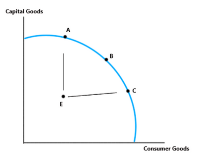
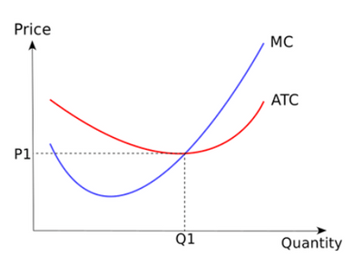
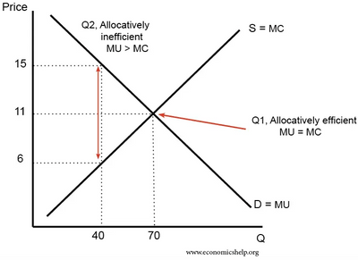
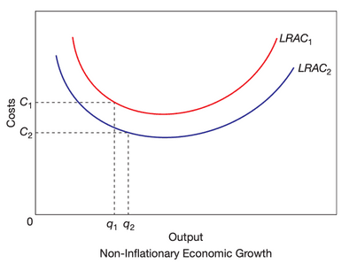

## Efficiency and Market Failure

**Economic Efficiency**: where scarce resources are used most efficiently to produce maximum output. Consists of:

- **Productive Efficiency**: When a firm is producing at the lowest possible cost.
- **Allocative Efficiency**: where price equals marginal cost; firms produce the goods and services most consumers want. No waste, both producers and consumers are satisfied with produced goods.
  - The marginal cost of production measures the opportunity cost of resources used to produce this unit.

### Productive Efficiency

- **Productive Efficiency** only exists when producing in the border of a PPC curve.
- Competition may lead to productive efficiency, forcing firms to lower prices and not go bankrupt, and will lead to firms reducing their costs to get the greatest possible profit.
- Perfect Competition pushes firms to long-run equilibrium in the market by producing at q and price at p. Lowest Average cost is achieved, leading to productive efficiency in the economy.

### Allocative Efficiency

- The table below, shows us the most allocative efficient output would be Quantity 4.

|Quantity|1|2|3|4|5|
|:---|:---|:---|:---|:---|:---|
|Price per unit|6|6|6|6|6|
|Marginal cost per unit|3|4|5|6|7|

- It cannot be expressed using a PPC curve. Any point on the frontier/border as long as the marginal cost and selling price are the same.
- **A competitive market** can lead to allocative efficiency. It leads to 2 motivations: motivation to make the greatest profit so they will produce the products with the highest level of demand; second, the other firms will be producing high-demand products, which forces other firms to do the same to prevent failure and closure of the firm.
- Allocative efficiency can be seen in the graph, where the marginal cost curve meets the price.

### Pareto Optimality

- **Pareto Optimality**: where it is impossible to make someone better off without making someone else worse off.
- If resource allocation is not Pareto efficient, then there is scope for improvement.
- Any improvement in economic efficiency will need some form of compensation to individuals negatively affected by the improvement.

### Dynamic Efficiency

- **Dynamic Efficiency**: a productive efficiency that benefits a firm over time. Resources are reallocated so that **output increases relative to the increase in resources.**
- The long-term phenomenon is achieved when firms meet the market's changing needs by introducing new production processes in response to competitive pressures and require investment with outside firms. When a firm becomes dynamically efficient, the long-run average cost curve shifts downwards.

### Market Failure

- Market Failure is when a free market fails to make the optimum use of scarce resources due to no government intervention. It is when a market's interaction between supply and demand does not lead to productive and/or allocative efficiency.
- Reasons for market failure (oversupply or undersupply of goods):
  - Externalities present in the market
  - No Provision of merit and demerit goods
  - No Provision of public and quasi-public goods
  - Information failure exists
  - Adverse selection or moral hazard
  - Abuse of monopoly power in the market