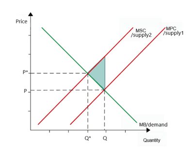
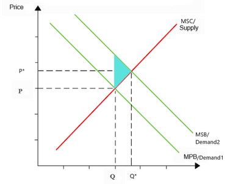

## Private Costs and Benefits, Externalities, Social Costs and Benefits

### Social Costs

Social Costs = Private Costs + External Costs

- **Social Costs**: the total costs of a particular action borne by all the society.
* **Private Costs**: those costs that are incurred by an individual who produces a good or service.
- **External Costs**: those costs incurred and paid for by third parties not involved in the action.

### Marginal Social Costs

Marginal Social Costs = Private Marginal Costs + External Marginal Costs

* **Marginal Social Costs**: the total cost society pays for the production of another unit or for taking further action in the economy.
* **Private Marginal Costs**: the change in the producer's total cost due to producing an additional unit of a good or service.
* **External Marginal Costs**: the change in the cost to parties other than the producer or buyer of a good or service due to the production of an additional unit of the good or service.

### Social Benefits

Social Benefits = Private Benefits + External Benefits

- **Social Benefits**: the total benefits arising from a particular action.
- **Private Benefits**: benefits that accrue to individuals who produce and consume a particular good.
- **External Benefits**: benefits received by third parties not involved in the action.
- If social benefits rise more than private, positive externalities are present.

### Marginal Social Benefits

Marginal Social Benefits = Marginal Private Benefits + Marginal External Benefits

- **Marginal Social Benefits**: the satisfaction experienced by consumers/producers of a specific good, plus the overall environmental and social benefits.
- **Marginal Private Benefits**: the total marginal benefits of every consumer for each quantity of good consumed.
- **Marginal External Benefits**: the benefit from consuming one more unit of a good or service that falls on people other than the consumer.
  - the 4 kinds of externalities (Positive consumption externalities, negative consumption externalities, Positive production externalities and negative production externalities)

### **Externalities**

- **Externalities**: where the actions of producers or consumers give rise to side effects on third parties who are not involved in the action; sometimes referred to as spillover effects.
- **Negative Externalities**: where side effects negatively impact and impose costs on third parties.
  - **Negative Production**
  - **Negative Consumption**
- **Positive Externalities**: where the side effects positively impact and benefit third parties.
  - **Positive Production**
  - **Positive Consumption**
- Arise through the actions of consumers and producers, distinction is sometimes not always clear.
- Externalities create the problem of an inappropriate amount of goods and services being produced. Firms do not usually take into account all social costs, only private. Thus, the overproduction of goods with negative externalities will continue due to no acknowledgement of social costs by private decision-makers.

 

- The graph above shows how Marginal private costs (MPC) is the level of supply currently produced, with price P and quantity Q; since **negative externalities of production are not acknowledged,** **firms overvalue (as it may seem like a higher profit margin) and hence overproduce,** and the market is in a disequilibrium.
- Only through government intervention and the acknowledgement of the negative externalities will the supply shift to the left, causing P to shift to P* and Q to shift to Q*, and will the market be in equilibrium.
- **Deadweight Welfare Loss**: A deadweight loss is a cost to society created by market inefficiency, which occurs when supply and demand are out of equilibrium.
  - Market inefficiency occurs when goods within the market are either **overvalued or undervalued.**
- Deadweight welfare loss is indicated by the triangle in the graph.

   

- Positive externalities may also cause deadweight loss. In the graph above, Marginal Private Benefit (MPB) is the level of current demand, with price P and quantity Q; since **Positive externalities of consumption are not acknowledged, consumers undervalue (since they are not aware of the actual benefit), and hence producers underproduce,** and the market is in disequilibrium.
- Only through government intervention and acknowledging the positive externalities will the demand shift to the right, causing P to shift to P* and Q to shift to Q*, and the market will be in equilibrium.

