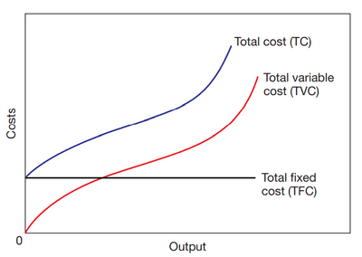
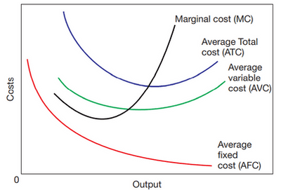
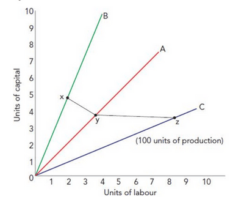
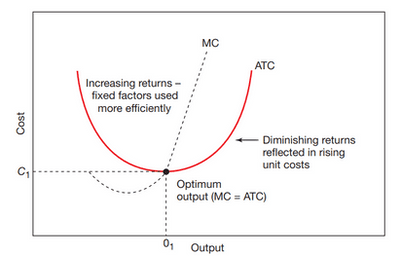

## Short-Run Production Function

- Short-run production function defines the relationship between 1 variable factor of production (while keeping the rest fixed) and output.
- Short-run is not a period of time, but rather a condition where not all factors of production are variable.
- **The production function** shows the maximum possible output from the given set of factor inputs.
  - **Formula: Q=AF(K, L)**, where Q is total output (Quantity), A is technology, and F is factors of production, with K being capital and L being labour.
- **Total product** is the total output a firm produces within a given period, utilising given inputs.
  - Total product = Average product x labour
- **Average product**, output per unit of inputs of variable factors.
  * $\text{Average product} = \frac{\text{Total product}}{\text{Labour}}$
- **Marginal product** is the addition of variable factors to the total product.
  * $\text{Marginal product} = \frac{\text{Changed output}}{\text{Changed input}}$
- **The Law of Diminishing Returns (law of variable proportions)** is where the output from an additional input unit leads to a fall in the marginal product.

### Short Run Cost Function

- **Fixed Costs**: Those costs are independent of output in the short run, so they are a straight line and don’t change with output.
- **Variable Costs**: those that vary directly with output; all costs are variable in the long run, so the graph is curved and changes with output
- **Total cost** = total fixed cost + total variable cost. It starts at the fixed cost line and follows the variable cost line, since it combines both.

- $\text{Average Fixed Cost} = \frac{\text{total fixed cost}}{\text{output}}$
- $\text{Average variable cost}=\frac{\text{total variable cost}}{\text{output}}$
- $\text{Average total cost} = \frac{\text{total cost}}{\text{output}}$
- $\text{Marginal cost} = \frac{\text{change in cost}}{\text{change in quantity}}$

* **Isoquant:** a curve that shows a particular output level over a combination of inputs. It is similar to the **indifference curve**. **Output refers to the total physical product**. 

  An example graph given below. The points x, y and z on the graph show the same output.

 

- **Optimum Output**: most efficient output at the lowest unit cost. Production efficiency in the short run.
- Optimum output ≠ profit maximisation (this is a long run).

- The short-run average cost curve (SRAC) shows us the optimum output point where marginal cost meets the lowest point of average total cost.
- The cup shape of the curve is because, initially, the **average cost reduces due to increased efficiency and better-fixed factors**, known as increasing returns. It continues to **drop until the Optimum output** is reached. Then, as the additional cost of producing more units becomes a burden (**increase in marginal cost**), diminishing returns happen, leading to increased average total cost and the slope turning **upward**.

