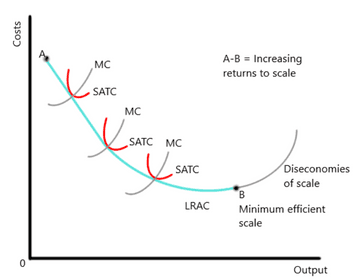
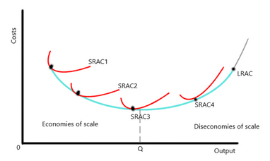

## Long-Run Production Function

- In the long run, all factors of production are variable. This allows factor input to be manipulated to find the most efficient level.
- **Increasing returns to scale**: where output increases proportionately faster than the increase in factor inputs.
- **Decreasing returns to scale**: where factor inputs increase at a proportionately faster rate than the increase in output.

### Long Run Cost Function

**Long-run cost**

- The reason the curve is sloping is because, over-time, economies of scale reduce costs and output increases (increasing returns to scale), but there will come a point where costs reach the lowest they can while output is highest, and once firms surpass that point, diseconomies start to gain.
- **Minimum Efficient Scale**: lowest level of output at which costs are minimised.
  - Low MES leads to a fragmented market, and high MES levels lead to a natural monopoly.

**Long-run average cost cure-envelope curve**

- LRAC is also known as the envelope curve, consisting of the short-run average costs over time.

