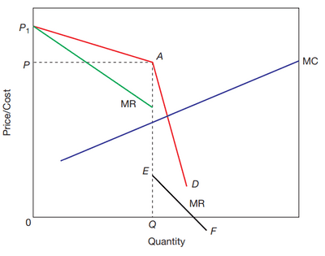
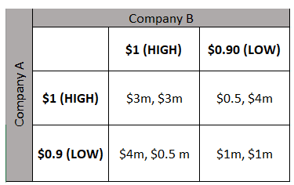

## Imperfect Competition

- any market structure except for perfect competition

### Monopolistic Competition

- Characteristic:
  - Numerous buyers and sellers
  - Few barriers to entry
  - Wide choice of differentiated products
  - Firms have some influence on market price
- Similar to perfect competition, except for product differentiation. This requires brand image, so advertising and promotion play a big role in this market structure.
- Firms can charge **prices above marginal cost**, which means as the firm makes more of the product, the price is lowered, and that’s why **marginal revenue is below the demand curve.**
- In the short-run, as firms aim to maximise/minimise profit, they will aim to produce where MC=MR; this has them making an **abnormal profit**. Like perfect competition, this creates **incentives for new firms to enter** due to **low barriers to entry**. But unlike perfect competition, firms can set their prices; this creates **competition** and **shifts prices from where it meets demand to where it meets** **ATC and MC.** This leads to losses, but as firms are free to exist, these **losses are turned into normal profits**.
- In the long run, firms will still produce where MC=MR; however, the demand curve would have **shifted to the left due to competition** and firms entering the market. This causes **normal profit and excess capacity**, as firms won’t produce at minimum ATC in the long run.

### Oligopoly

- Characteristics:
  - Dominated market by a few firms
  - Decisions are interdependent on rival strategies/reactions.
  - High or substantial barriers to entry
  - Products may be differentiated or not.
  - The uncertainty and risk associated with price competition may lead to price rigidity.
- Oligopoly behaviour can follow 2 routes, **aggressive competition in the form of price wars** and another less risky approach through **non-price competition to increase revenue and horizontal integration**.
- **Non-Price Competition**
  - physical characteristics
  - location
  - service level
  - advertising
- The second route is **cooperation and collusion**.
  - Cooperation like research and development, where firms pool their knowledge and perhaps participate in joint ventures.
  - Collusion is different; it is **anticompetitive action** by producers;
- **Price Leadership**: a situation in a market whereby a particular firm has the power to change prices, the result of which is that competitors follow the lead.
- **Cartel**: a formal agreement between firms to limit competition by limiting output or fixing prices.

### Main Theories to Attempt to Explain Oligopolistic Behaviour

**The Kinked Demand Curve**

- is a means of analysing firms' behaviour in an oligopoly without collusion.
- The kinked demand curve shows how oligopoly firms won’t be able to have price competition, and that will lead to the temptation to collude.

 

**Impact of Price Rise**

- In the graph above, p is the equilibrium price; if the price rises above that, there will be a **Reverse** **movement along the demand curv**e, causing a **reduction in Q (quantity)** and a **reduction in MR (marginal revenue)**.
- If a firm increases the price, it becomes more expensive than its rivals, so **consumers will switch to its rivals.**
- Therefore, for a price rise, there is likely to be a **significant fall in demand**. Demand is, therefore, **price elastic**.
- In this case, by increasing price, firms will **lose revenue** because the percentage fall in demand is greater than the percentage rise in price.

**Impact of Price Cut**

- In the graph above, p is the equilibrium price; if the price reduces below that, there will be **Forward** **movement along the demand curve**, causing a **slight increase in Q (quantity)**, a **reduction in MR (marginal revenue)** and a **significant increase in MC (marginal cost).**
- If a firm cut its price, it will likely lead to a different effect. In the **short term**, if a firm cuts price, it would cause a **big increase in demand**, leading to a **rise in revenue**. The firm would **gain market share**.
- However, **other firms will not want to see this rise in market share, so they will respond by also cutting prices to follow the first firm**. The **net effect** is that if all firms cut-price – the individual firm will **only see a small increase in demand**.
- Because there is a ‘price war’, demand for a firm is **price inelastic – there is a smaller percentage rise in demand.**
- If **demand is inelastic and price falls**, then **revenue will fall**.

**Game Theory**

- Showcases interdependences that a kinked demand curve cannot showcase.

- This diagram showcases the different options a firm can decide based on competition and price.
- **Prisoners’ dilemma** is showcased here, with a **Nash equilibrium** and **dominant strategy.**
- **The Nash Equilibrium**: a decision-making theorem within game theory that states a player can achieve the desired outcome by not deviating from their initial strategy. In this case, the Nash equilibrium is either selling for 1 dollar for companies A and B, where each gets 3 million in return.
- **Dominant Strategy**: ~~the optimal option for a player among all the competitive strategy sets, no matter how that player's opponents may play. Company A would prefer to sell at 0.9 dollars to gain 4 million in the above example.~~
- **Prisoners’ Dilemma**: when both parties are under the guise of guilty, where if both fess up, punishment is shared if one is proven guilty, full punishment, This causes both parties to be in a dilemma. Related to pricing strategy.
- **Principal Agent Problem**: a principal hires an agent to own the business, but there is a case of info. Failure, since the principal, cannot ensure that the appointed agent makes the necessary decisions to run the firm in the best interests of shareholders. For ex. the agent is following the objective of satisfying, whereas the principal believes he or she is implementing a policy of profit maximisation.
- Price rigidity (non-price competition) like the Nash equilibrium is not the best outcome, therefore pushes firms to collude and use tactic collusion.
- It also provides an incentive to cheat on collusive agreements, which could put firms at risk of being caught, which could reflect negatively.

**Monopoly**

- A pure monopoly is a single firm, but in real life, a monopoly can be a firm with a large percentage of market share and a mass dominant position.
- **In theory characteristic:**
  - Single seller
  - No close substitutes
  - High barriers to entry
  - The monopolist is the price maker
- **Local monopolies** can exist because it could be too costly for the others to set up, even tho it could be a small firm.
- No distinction between short-run and long-run due to barriers of entry and no economic incentive for the monopolist to move away.
- Monopoly sets prices higher than market equilibrium (where MC=ATC), causing them to make supernormal (abnormal) profits. This would normally attract new firms, but due to the higher barriers of entry, no effect on the profit occurs.
- **Natural Monopoly:**
  - Where a single supplier has a substantial **cost advantage** such that competing producers would raise costs and where duplication will produce an inefficient use of resources. This can also be done by the government, for example, utilities, because private firms may exploit the customers.
  - It could be making an **abnormal profit**, but if it behaved like a competitor firm, equilibrium is where **price = long-run marginal cost**. This leads to price and added quantity loss, causing a loss without government subsidies. That is why being in the public sector is more logical.
- **Positives of Monopoly**
  - a monopolist cannot always make abnormal profit
  - the competitive market has an uncertainty of profits - monopolists can invest in this and provide better **quality products and job security.**
  - **Investment** may take the form of process innovation.
  - Profit would be used to **finance product innovation**.
  - If the benefits of economies of scale were passed on to **consumers,** they would have gained from it.

**Comparing Monopoly and Perfect Competition**

- Monopoly price higher than perfect
- Monopoly output lower
- Monopolists making long and short-run abnormal profits
- Productive efficiency and producing optimum output in perfect competition and also allocative efficiency, price = MC.
- Monopolists take consumer surplus and make abnormal profits.
- **X inefficiency** - where the typical costs exceed those experienced in a more competitive market. This happens when the firm lacks the incentives to lower the costs.
- The monopoly firm is productively inefficient, producing less than the optimum output in the search for extra profit. The price change is well above marginal cost and is not allocative efficiency.
- If a perfectly competitive industry were turned into a monopoly, there would be a **welfare loss of area x** and greater allocative inefficiency.

