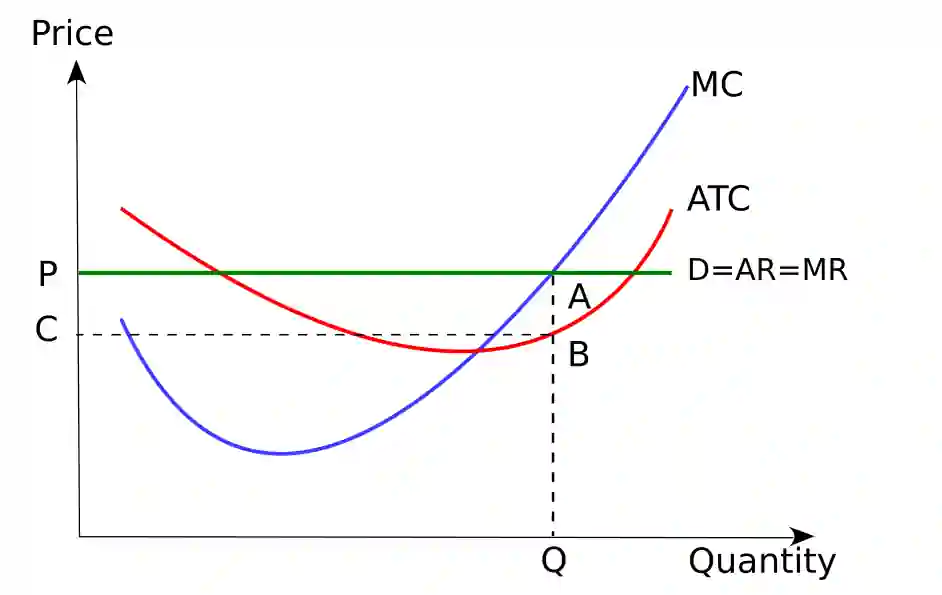
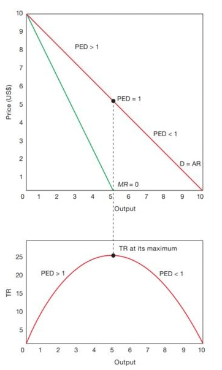

## Differing Objectives and Policies of Firms

* **Profit Maximisation**

  * Firms want to increase the level of profit they receive from given output. Thus, why is profit maximisation an objective?

* In the graph above, when the **marginal revenue is greater than the marginal cost**, the firm gains increasing profit levels, at which MC=MR is the maximum profit level for the given output. However, if the **marginal cost exceeds marginal revenue**, the firm will be making a **decrease in profit for each unit produced.**

* **Short-term profit maximisation may not be of interest long term:**

  * Avoidance of government watch
  * Large abnormalities may attract new entrants
  * High profits may decrease relationships with stakeholders.
  * Management may have different objectives.

* **Survival**

  * The very common objective, the first objective of a new startup, and the prioritized objective to a declining in-loss firm.
  * It's not a profit-centred objective.
  * Survival objectives ensure the firm is operating, regardless of profit. This objective focuses on ensuring the business doesn’t fall into a loss and has enough to cover its Total costs.

* **Profit Satisficing**

  * A firm aims to make a reasonable profit level to satisfice all shareholders.

* **Sales Maximisation**: a firm’s objective to maximise the volume of sales.

  * **Cross subsidisation** (the strategy of funding one product with the profits of another) is used since higher output relative to revenue causes loss, and firms need ways to cover ATC.
  * This objective may **draw new entrants** but can be **deterred by price wars**.

* **Revenue Maximisation**

  * A firm’s objective to maximise turnover, **MR=0.**
  * Accept low prices and above profit maximisation output to increase market share, called **penetration pricing policy.**
  * It can be favoured if management salaries are linked to the value of sales.

### **Pricing Policies**

**Price Discrimination**: 3 recognised types of price discrimination:

* **First Degree**: The firm sells at different prices for different consumers based on their ability /willingness to pay. The main focus is on **maximising willingness to pay**
  * **Demand curve = MC**
  * **Price = MR**
* **Second Degree**: Consumers will only buy more of a product when the additional units are lower in price, which causes firms to charge a **higher price for the first unit and lower for the successive**.
  * Total revenue and profit rise.
* **Third Degree**: Discriminate between consumers based on the **presumption that groups of consumers** have a **different price elasticity demand** for the product.
* The aim of price discrimination, if taking a**dvantage of consumer surplus, is to maximise producer surplus.**
* **Conditions for Price Discrimination:**
  * The **degree of monopoly power** needs to be a price maker.
  * Be able to **identify the different market segments**.
  * The **elasticity of demand** for different consumers is known.
  * Firms need to **prevent re-sale** of products by consumers. This could result in the exploitation of consumers.

|Consequences for Consumers|Consequences for Producers|
|:---|:---|
|Lower prices for some consumers|**Increased revenue** through increased profit-making opportunities. Helps businesses to make up losses|
|Reduce consumer surplus|Regulated demand can help reduce the crowd in peak season and increase during the off-season.|
|With lower product choices, monopolies can take advantage to achieve greater market share and establish a high barrier to entry. This reduces welfare, and lower-income consumers may be unable to afford it.|Administration costs, for example, the costs spent to prevent the reselling of goods.|
|Creates unfairness in society||

* **Limit Pricing**: seeks to keep firms out of the market. Short-term method used by oligopolists and monopolists.
* **Predatory Pricing**: Prices are set very low, sometimes below average total cost, to drive out competition and create a monopoly.
* **Price Leadership**: Commonly used by oligopolies, the highest market share business sets lower short-term prices, and the rest follow. This can cause a small business to be driven out.

**Note: relationship between price elasticity of demand, marginal revenue and total revenue.**

* MR and PED have a direct relationship: Positive MR= Elastic demand, Negative MR=Inelastic demand.
* MR is a part of the total revenue. MR is used to find the optimum output level that maximises sales and profit; positive MR= TR increases, and negative MR= TR decreases.

