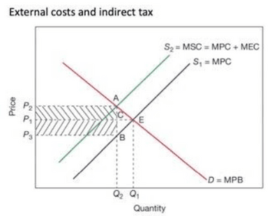
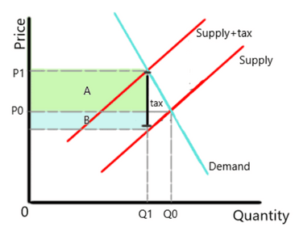
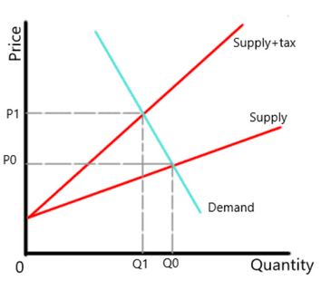
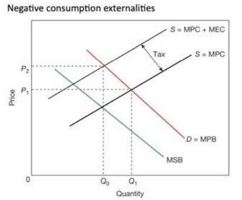
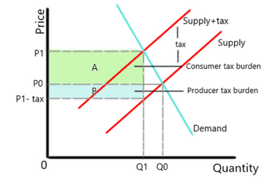
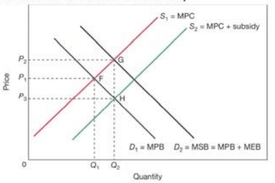

# Government Microeconomic Intervention

## Measures to Tackle Different Forms of Market Failure

- The demand curve, also known as the Marginal Private Benefit (MPB)
- The supply curve, also known as the Marginal Private Cost (MPC)
- Equilibrium in the market is where **Marginal Social Costs (true level of supply) = Marginal Social Benefits (true level of demand)**.
- **Market Failure** is an inefficient distribution of goods and services in the free market.
- **Causes of market failure:**
  - Negative production externalities
  - Negative consumption externalities
  - Positive production externalities
  - Positive consumption externalities

### Negative Production Externalities

 

- Negative production externalities cause market failure due to the inefficient distribution of resources due to overproduction (as they only consider private costs).
- Distance AB is MEC (Marginal external cost), and the ideal situation is where indirect tax = MEC.
- Tax burden is shared by **producer (P1, C, B, P3)** and **consumer (P2, A, C, P1)**

### Measures to Realise Negative Production Externalities

- **Specific Indirect Tax**: an indirect tax charged at a fixed rate on sales of goods and services.

- The tax effect here is a shift in the supply curve, causing the equilibrium from P0 to P1 and Q0 to Q1.
- The **tax revenue for the government would be the shaded area AB**, A being the consumer tax portion and B being the producer tax portion.
- **Ad valorem tax**: an indirect tax charged as a percentage of the price of a good or service.

- The effect of the tax is shifting the slope of the supply curve, which causes the price to shift from P0 to P1 and the quantity from Q0 to Q1.
- **Regulation**: a wide range of legal and other requirements from the government and other organisations.
  - This makes producing products with negative externalities higher in cost. Discouraging firms from producing.
- **Property Rights:** Where owners can decide how their assets may be used. 2 possibilities:
  - Polluting firms have the rights. This means it can stop its polluting activities if paid compensation for its loss or gets paid to leave, which would require government intervention through the warning of new regulations.
  - The affected party would have the rights and can sue the company; however, it depends on bargaining power.
- **Pollution Permits**: a form of licence given by governments that allows a firm to pollute up to a certain level. Firms and countries can sell permits; they control the quantity and price of permits according to the effect desired.
- **Licensing**: Permits a firm to operate in specific markets or locations, e.g. to operate as a pub or a taxi business. 2 types of licensing:
  - **Exclusive**: Licensing given to only 1 firm.
  - **Non-exclusive**: licensing to more operators at a lower price than exclusive licence.
  - These result in restrictions on entry into the market.

### **Negative Externalities in Consumption**

 

* Consumers cause spillover costs.
* MSB is lower due to external cost, but MPB has caused an increase in demand that is met with over-estimated supply, as the MEC is not considered.
* Imposing indirect tax shifts quantity from Q1 to Q0 and price from P1 to P2.

### **Measures to Realise Negative Consumption Externalities**

- **Indirect Tax**
  - Specific indirect Tax deters consumers from purchasing due to the high consumer tax burden.

 

- **Minimum Price Controls**
  - Minimum price controls/price flooring reduces the incentives for consumers to buy demerit goods, as the price is higher than equilibrium.
- **Provision of Information**
  - Governments actively provide information to educate consumers about the content and long-term/short-term negative effects of demerit goods.
- **Production Quotas**
  - The government restricting the quantity firms supply will limit the demand.

### Positive Production Externalities

 

- Spillover benefits created by producers.
- Subsidies allow a rightward supply shift by adding external benefits fixes, allowing for lower prices, more quantity, and an accurate social cost (MSC).
- Market failure caused by production externalities is usually due to the lack of incentives for firms to produce, causing an **underproduction of these goods**.
- This leads to Allocative inefficiency and, thus, market failure.

### Measures to Realise Positive Production Externalities

- **Subsidies**:

   

- Subsidies provided by the government incentivise firms to produce these merit goods for society.
  - This is shown above through the shift from S1 to S2, an increase in supply, price changes from P2 to P3, and a quantity from Q1 to Q2.
- **Provision of Information**
  - Governments providing firms with the long-term effects of producing the merit goods and how that will positively affect business performance over time will incentivise firms to produce.

### Positive Consumption Externalities

 

- It occurs as a result of decisions made that impact consumers favourably.
- **Original equilibrium (F)** shows MPC = MPB, but as external benefits are realised, this equilibrium shifts to point G, with more quantity at price P2. Subsidies are introduced to reduce the burden on firms, so the supply shifts right, making price P3 and the new equilibrium at point H.

### Measures to Realise Positive Consumption Externalities

- **Direct Provision**
  - Informing consumers about the contents and long-term/short-term benefits of merit goods will increase their awareness and result in them consuming more.
- **Subsidies**
  - Providing subsidies to firms will reduce the prices of merit goods and increase their quantity, incentivising the demand to increase.

### Other Measures to Correct Market Failure

**Nationalisation**

- **Nationalisation**: governments take over a private sector business and transfer it to the public sector.
- As private sector businesses are MPC and MPB-motivated, they often underproduce merit and public goods. Using nationalism will increase positive externalities by supplying more to consumers (encourages positive consumption externalities) and increasing demand.
- Nationalisation will also reduce negative externalities by restricting consumer supply and lowering demand.

**Privatisation**

- **Privatisation**: selling a state-owned public sector business to the private sector.
- Privatisation allows for increased competition, forcing firms to be more efficient in allocating their resources.

**Deregulations**

- **Deregulation**: occurs when the government removes or reduces the restrictions in a particular industry to improve business operations and increase competition.
- Removing regulation from the market will allow the free market forces to balance itself out naturally.
- Governments can steer the market forces by implementing other policies.

### Nudge Theory

- **Nudge Theory** is a way of achieving beneficial economic and social outcomes without regulations.
- It is a way to indirectly manipulate people into taking specific or desired outcomes.
- This is done by providing information to consumers/producers and making them aware of specific accepts, e.g., the harmful effects of demerit goods or the benefits of merit goods.

