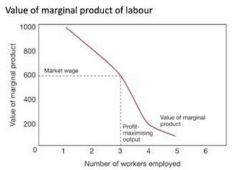
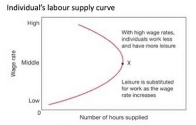
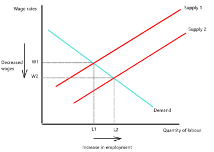

## Labour Market Forces and Government Intervention

### The Demand for Labour

- **Labour Demand**: a concept that describes the demand for labour that an economy or firm is willing to employ at a given time.
* **Derived Demand**: demand for a good or service depends upon the use that can be made from it.
- **Labour Demand is a Derived Demand**, increasing when the need/use of labour increases. However, it is based on 2 assumptions:
  - The firm operating in a competitive market
  - The firm is a profit maximiser
- **Factors affecting demand for labour**:
  - **The wage rate** is the compensation for labour. The wage rate affects the willingness of firms to employ labour; the higher the minimum wage, the less labour is demanded by firms.
  - **Productivity of Labour** is the amount of goods and services produced in a given time. If the firm operates at a low productivity, it will demand more labour to increase that productivity.
  - Productivity of labour is affected by the law of diminishing returns, meaning that at a marginal rate, after a certain number, more workers will mean less productivity.
  - **Demand for the Product**. The greater the demand for the product, the more firms are willing to supply; therefore, the demand for labour increases.

**The Demand Curve for Labour:**

- Movement along the demand curve for labour results from a change in a price of labour (wage rates) which causes changes in the firm’s willingness to employ labour. e.g. The higher the minimum wage, the less the firms demand labour, causing a leftward/upward movement along the curve.
- **Shifts in the demand curve** depend on the **level of labour firms required for production**. e.g., high demand for a product will mean increased production capacity for firms, thus the need for more labour and a rightward shift in the curve.
  - These shifts could also be due to increased labour skills (due to education and training), which would help lower production costs.
  - The increased use and progress of capital machinery and technology could result in a leftward shift in the curve due to fewer levels of demand required by firms.
- **Marginal Revenue Product (MRP)**: the addition to total revenue from employing one or more workers.

- Firms hire as long as the additional worker adds more to revenue. This essentially means that MRP shows us the **derived demand for labour**.
- The **profit-maximising output is where the highest level of additional units meets the lowest level of workers needed**.
- The **equilibrium point of the highest additional unit for the lowest number of labourers** also helps us determine **market wage**.

### **The Supply Labour**

- The supply of labour is the **number of hours that labour is able and willing to work for a particular wage rate**.
- **Factors affecting the supply of labour:**
  - They are classified into wage and non-wage factors. Non-wage factors consider job satisfaction. Individuals consider both of these factors, known as **net advantage**.
    - **Net advantage:** sum of the utility derived from receiving a wage as well as the utility derived from working in that certain occupation
    - The increase in net advantage will result in **more labour being supplied**.
  - **Wages Rates**: The higher wages, the more willing workers are to trade in their leisure time. The wage has a **positive relationship with the supply of labour.**
    - Wage rates in **different occupations affect the supply of labour in each industry**. For example, a salesperson gets paid more than a production worker.
  - **Income tax affects the percentage of real income workers receive; the higher the income tax, the less** incentive to join the workforce.
  - **Skills and Qualifications**: The higher the education and qualification needed, the lower the supply.
  - **Non-pecuniary benefits**: These non-cash benefits by the government can create a **disincentive for employment** in the population, reducing the labour supply.

**The Supply Curve for Labour**:

- Above is the individual supply of labour, which shows the relationship between wage rates and hours supplied.
- Workers don’t mind giving up more leisure time for more income as wage rates rise.
- A **positive relationship** continues until wage rates reach an **optimum point**, where consumers are **satisfied with their income and wish to enjoy** the income with more leisure time.

- This is the supply of labour curve in the market. Movement along the supply curve is due to changes in wage rates. Upward/rightward movement along the supply curve is due to wage increases.
- Shifts in the supply curve are due to **increased labour capacity** in the market. For example, stable growth and an higher birth rates will mean the size of the population grows, meaning an **increase in the working population percentage**.
  - Depending on how individuals view leisure time (either as an inferior or normal good), an **increase in income will lead to an increase in leisure time** if it is considered a **normal good**, in the case if it is considered an **inferior good,** an **increased income will lead to a decreased leisure**. This causes either a left shift (Normal good) or a right shift (Inferior good).
  - **Changes in population**, such as immigration rate, will increase the market's supply level. An increase in retirement age would cause a decrease/left shift in the curve.