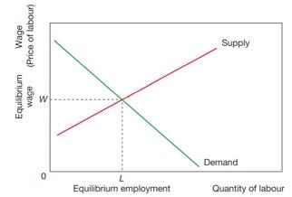
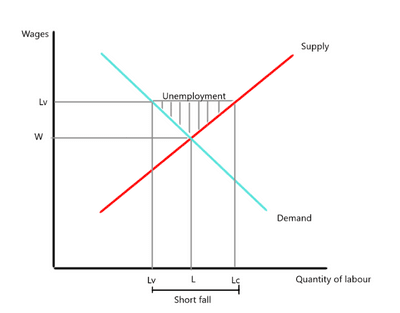

## Wage Determination in Perfect and Imperfect Market

### **Wage Determination in a Perfect Market**

* The equilibrium in the labour market is determined by market forces when supply meets demand.
* Wages and level of employment are determined using that equilibrium.
* Any increase in demand will cause an increase in wages and employment.
* Any increase in supply will cause a decrease in wages and an increase in employment.

### **Wage Determination in an Imperfect Market**

* In an imperfect market, the equilibrium is influenced by many factors, which result in either workers or employers determining wages.

* Government and trade union affect demand and supply through:

  

  * An **imposed wage by the trade union** will result in more labour supply, but demand will decrease from the equilibrium of L to Lv. This can cause unemployment in the market.
  * The government may try to set a **minimum wage**, which also affects supply and demand, depending on the elasticity of labour. The more elastic the demand is, the greater the fall in demand in response to the introduction of minimum wage, causing significant loss in employment. On the other hand, inelastic demand for labour will not cause a significant loss of employment after imposing a minimum wage.

* **Monopsony**: where there is a single buyer in the market.

  * Wages are set based on **marginal cost and marginal revenue product**. Since the employer holds all the power, they **exploit workers** and **set wages lower than the marginal revenue.**
  * Monopsony can restrict employment, allowing them to **employ fewer workers at lower wages**.

### **Wage Differentials**

* **Wage Differentials**: the difference in pay between workers with different skills and responsibilities
* This difference is a result of work ability and effort.
* **The cause of wage differential:**
  * Supply factors, such as:
    * **Experience**: The more job experience the individual has, the more valuable he becomes. Hence, he earns a higher wage.
    * **Education**: The level of education determines the skills and knowledge in the particular occupation, which is deemed a higher wage.
  * Demand factors, such as:
    * **Industry Type**: Industries may have different values to the same job title, e.g. a cashier in a fast food chain (responsible for financial transactions) and an accountant in a company (also responsible for financial transactions).
    * **Demand for that occupation**: As the industry progresses, certain skills and occupations rise in demand, while others become irrelevant. Technical skills are rising in demand, making them valuable to the industry; hence, higher wages are needed to attract those skills.