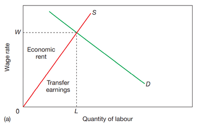

## Transfer Earnings and Economic Rent

 

- **Transfer Earning**: the amount earned by a factor of production in its best alternative use.
  - Meaning the minimum payment needed to keep labour in its current occupation.
  - The supply curve shows us the minimum wage people are willing to work at.
- **Economic Rent**: a payment made to a factor of production above that which is necessary to keep it in its current use.
- The elasticity of labour supply affects the economic rent and transfer earnings.
  - The more **elastic the labour supply** is, the **higher the transfer earnings** compared to economic rent.
    - The lower-skilled the job is, the more elastic (many alternative people to replace that position). For example, cleaners get paid slightly above their transfer earnings since they might decide to live off welfare benefits if they get paid lower.
  - The more **inelastic labour supply**, the **higher the economic rent** compared to transfer earnings.
    - The more skilled the job is, the more inelastic it is (there are not many alternative people to replace the position).
    - Footballers get paid a lot higher than what they initially were willing to work for; since there are not many professional footballers in the world (meaning they are inelastic in supply), they get a higher portion of economic rent.

