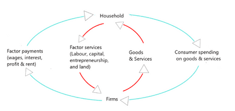
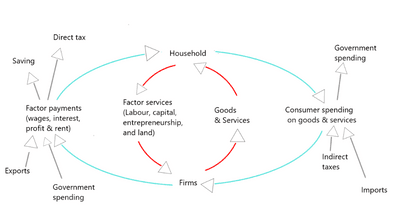

# The Macroeconomy

## The Circular Flow of Income

- **Open Economy**: an economy that is involved in trade with other economies.
- **Closed Economy**: an economy that does not trade with other economies.
- **Circular Flow of Income**: a simple model of how income flows around the economy.
- The circular flow of income in a closed economy:

     
  
- The circular flow of income in an open economy

     

### The Multiplier

- **Multiplier**: an economic factor that, when increased or changed, causes increases or changes in many other related economic variables. Also known as the **national income multiplier**
- **The Multiplier Effect** is the proportional increase or decrease in final income resulting from an injection or withdrawal of spending.
- The larger the number of the multiplier, the larger the change in national income
- $\text{Formula 1}=\frac{\text{Change in income}}{\text{Change in injection}}$, this one is used in closed economy
- $\text{Formula 2} = \frac{\text{1}}{\text{Marginal propensity to withdraw}}$, this one used in open economy.

**Two-Sector Economy**:
- Indicates household and firms
- **Marginal Propensity to Save (MPS)**: the proportion of extra income saved.
$\text{Formula} = \frac{1}{\text{MPS}}$. Or $\frac{1}{\text{1-MPC}}$
- Income is where aggregate expenditure=output,
  - C (consumption, consumers) + I (Investment, firms) = Y (income)
- Injections equal withdrawals,
  - I (investment) = S (saving)

**Three-Sector Economy**:
- The addition here is the government. We have injection here in the form of government spending and withdrawal in the form of taxation.
- **Marginal Rate Taxation(MRT)**: the proportion of extra income taken in tax.
$\text{Formula} = \frac{1}{\text{MPS+MRT}}$
- Income is where aggregate expenditure=output,
  -C  + I + G = Y
- Injections equal withdrawals,
  - I + G = S + T

**Four-Sector Economy**:
- Household, firms, government and foreign trade sectors. This is an open economy.
- M denotes imports, and X denotes Exports.
  - **Net export is X-M.**
- Income is where aggregate expenditure=output,
  - C  + I + G + (X-M) = Y
-Injections equal withdrawals,
     * I + G + X = S + T +M
- Having 3 propensities to withdraw would mean the multiplier will have a small effect, but 3 injections would mean more opportunities for GDP to change.
- **Marginal Propensity to Import(MPM)**: the proportion of extra income spent on imports.
  - $\text{Formula} = \frac{1}{\text{MPS+MRT+MPM}}$
- **Marginal Propensity to Withdraw(MPW)**: The addition of MPS+MRT+MPM together.
  -  $\text{Formula} = \frac{1}{\text{MPW}}$
-  **Average Propensity to Consume (APC)**: the proportion of consumed income.
  - $\text{Formula} = \frac{\text{Total Consumption C}}{\text{Income Y}}$
- If disposable income is spent to meet current needs, the person/country is poor.
- **Dissaving**: spending financed from past savings or borrowing.
- **Saving**: income minus consumption.
- **Average Propensity to Save(APS)**: the proportion of saved income.
  - $\text{Formula} = \frac{\text{Total Saving S}}{\text{Income Y}}$
  - Apc-1= APS
- **Marginal Propensity to Consume(MPC)**: the proportion of extra income spent.
  - $\text{Formula} = \frac{\text{Change in consumption}}{\text{Change in income}}$
- **Average Propensity to Import (APM**): the ratio of total imports to total income.
  - $\text{Formula} = \frac{\text{Total Imports M}}{\text{Income Y}}$
- **Average Rate of Tax (ART)**: the total tax paid divided by taxable income.
  - $\text{Formula} = \frac{\text{Tax paid/due}}{\text{Total taxable income}}$

