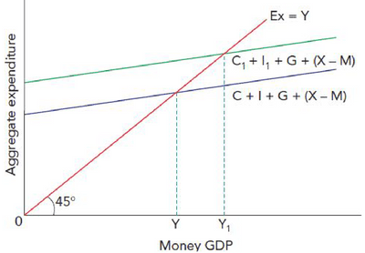

## National Income Determination

* **National Income**: the sum of the economy's income on an aggregate level. It is an essential measure of economic performance.

* The level of national income in an economy is determined where aggregate demand equals aggregate supply. This is where aggregate expenditure = output.

* **Aggregate Expenditure**: the total amount spent in the economy at different income levels. Made up of consumption, investment, government spending, and net exports (X-M).

* An increase in expenditure leads to an increase in output.

* Above is a Keynesian 45° diagram; it shows the relationship between money GDP and aggregate expenditure.

---

* A change in the aggregate expenditure (total spending on a country’s goods and services) will result in national income changing by the size of the injection times the multiplier.

* An increase in AD would mean an increase in income; this increases spending and consumption, leading to more income, and the multiplier effect occurs until leakages equal the initial injection. This would result in a rise in GDP and, therefore, national income.

* An increase in savings would decrease AD, which, with the multiplier effect, would lead to decreased income spending and reduced GDP (national income).

* Example: If the government chose to inject (rise in spending) 300m dollars, with the multiplier being 2, national income would rise by 600m.

### **Components of Aggregate Demand and their Determinants**

**Consumption**

* **Consumption**: Spending by households on goods and services.
* **Disposable Income**: income minus direct tax plus state benefits. The main influence on consumption.
* **Consumption Function**: the relationship between income and consumption.
  * Equation, C= a+bY, C is consumption, ‘a’ is autonomous consumption (amount spent when income is zero and doesn’t change with income), ‘b‘ is the marginal propensity to consume, and Y is disposable income. ‘bY’ can also be known as income-induced consumption.
* **Saving Function**: the relationship between income and saving. Reverse of consumption function.
  * Equation, S= -a+sY, S is the marginal propensity to save; a is autonomous dissaving (how much saving will be drawn when income is zero, does not change as income changes). ‘sY’ is induced saving.

### **Investment**

* **Investment**: spending by firms on capital goods.
  * **Influenced by:**
    * Changes in demand
    * Rate of interest
    * Technology
    * Cost of capital goods
    * Expectation of firms
    * Government policy.
  * **Autonomous Investment**: Investment that is undertaken independently of changes in income.
  * **Induced Investment**: investment that is influenced by changes in income.
* **Accelator Theory**: a model that suggests investment depends on the rate of change in income and that a change in GDP will cause a greater proportionate change in investment.
  * An increase in the national income (GDP) rate will result in a larger increase in the overall level of investment.
  * Consumption increase → GDP rises → Firms either chose to:
    * Use capacity (**Does not increase investment**) → firms are not confident.
    * Increase capacity by buying capital goods (i**ncrease investment**) → Firms have confidence that the rise will be sustained.
  * Consumer demand rose by 20%, and gross investment has increased by 100%.

|Time Period (Year)|Consumer Demand|Capital at the start of the period|Capital Required to meet demand|Replacement due to Depreciation|Net Investment|Gross Investment|
|:---|:---|:---|:---|:---|:---|:---|
|1|50|10|10|2|0|2|
|2|60|10|12|2|2|4|

* **Investment does not always increase by the change in demand**; if a firm can better use spare capacity, improving technology will limit the need for further investment. As well as, if capital goods producers are working too much to meet demands, fewer capital goods are available.
* **Capital-Output Ratio**: a measure of the capital used to produce a given amount or value of output.

### **Government Spending**

* **Government Spending**: the total of local and national government expenditure.
  * Influenced by
  * Government policy
  * Tax revenue
  * Demographic changes

### **Net Exports**

* **Net Exports**: exports minus imports.
  * Influenced by:
  * Country’s GDP
  * Other countries GDP
  * The relative price and quality competitiveness of the country’s products
  * Exchange rate