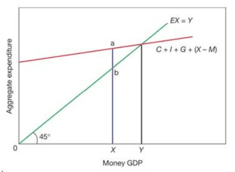
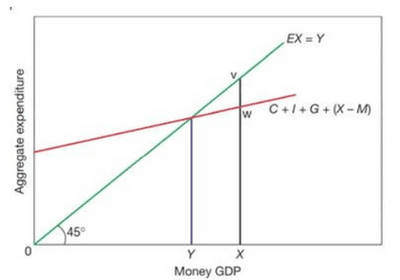

## Inflationary and Deflationary Gap

- **Full Employment Level of National Income**: maximum output level where everyone available is employed, and no more output can be produced.
- Economies produce where total spending is above/below what is needed for national income to equal potential output.
- The equilibrium level for national income is where **the aggregate supply and demand are equal**.
- **Inflationary Gap**: the excess of the aggregate expenditure over potential output. (equivalent to a positive output gap).
- This is caused by excess demand not being met due to inadequate resources.

- The national income equilibrium is at GDP point Y (achieved with the full employment of resources), above the output level currently produced at X. The Inflationary gap is the ‘ab’.
- A cut in government spending will bring down the inflation gap.
- **Deflationary Gap**: a shortage of aggregate expenditure so that potential output is not reached. (Equivalent to a negative output gap)

- The national income equilibrium is at GDP point Y (due to lack of expenditure), below the level of output X. The deflationary gap is ‘vw’.
- An increase in government spending brings up the deflationary gap.

