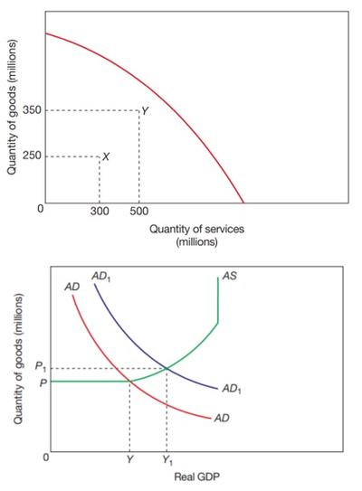
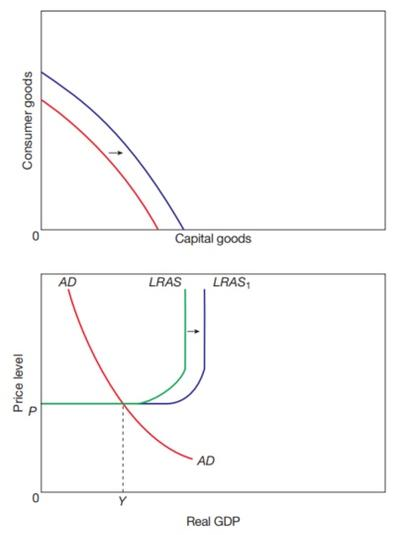
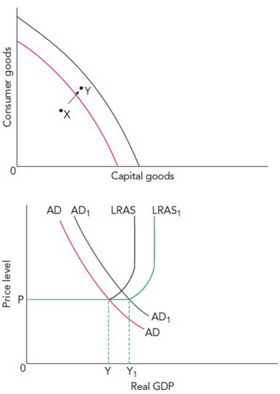
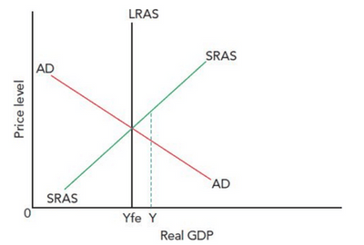
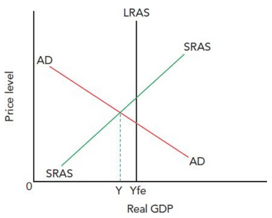

## Economic Growth

* **Actual Economic Growth:** when output increases. It is sometimes referred to as short-run economic growth.
* **Actual Economic Growth on PPC and AD/AS diagram**
  * In the PPC curve, an increase from X to Y results from better utilisation of existing resources or the utilisation of more resources.
  * In the AD/AS diagram, the shift in the demand curve to the right causes actual economic growth that leads to output from Y to Y1.

 

* **Potential Growth:** an increase in the production capacity. Sometimes called the long-run economic growth.
* **Potential Economic Growth on PPC and AD/AS Diagram**
  * In the PPC curve, a shift shows us the maximum output increase the economy can produce.
  * In the AD/AS diagram, the LRAS (Long-run supply curve) shift also shows us the maximum capable output increasing.

 

* **The Potential Growth and Actual Growth**:
  * The PPC curve shifts (maximum potential) and moves from point X to Y (increased output).
  * In the AD/AS diagram, a rightward shift in both AD and LRAS shows a shift from Y to Y1 in real GDP.
  * Combining leads to development and progress since the combination can increase output, income and the quantity and quality of resources.

 

### **Output Gaps**

* The **difference between Potential and Actual Economic Growth** is the output gap.
* **Positive Output Gap**: a situation where actual output is above potential output.

  * The positive output gap is from Yfe to Y, showing us that the actual output occurring is more than what was put in the potential
* **Negative Output Gap**: a situation where actual output is below potential output

  * The negative output gap is shown from Y to Yfe; due to a lack of aggregate demand, resources are not being employed well, causing the economy not to produce at its potential.
* Increased mobility & flexibility
* More efficient allocation
* New export markets
* Corporate tax reduction
* The upturn in the business cycle
* Increase in labour force
* Labour quality improvement
* More research & development
* Technological advances
* Net investment in capital stock
* Capital-intensive production

