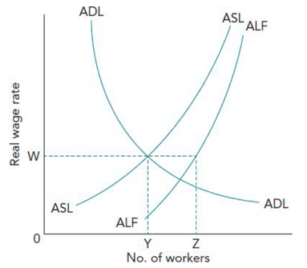
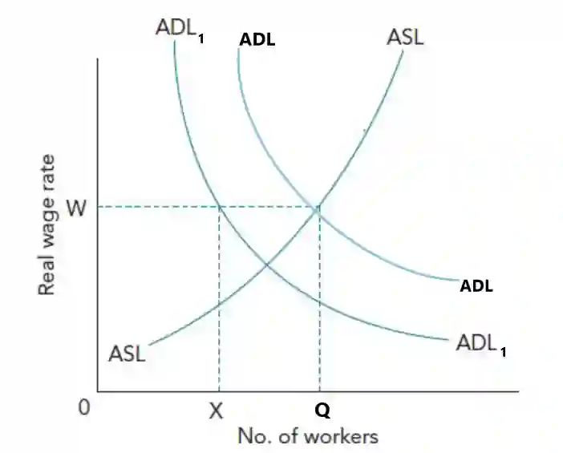

## Employment and Unemployment

* **Full Employment**: the level of employment corresponding to where all who wish to work have found jobs, excluding frictional unemployment.
  * Usually considered when the unemployment rate falls to 3% and not 0% because, at any particular time, people may be experiencing unemployment due to switching jobs (frictional unemployment).

**Equilibrium Unemployment**

* **Equilibrium Unemployment**: unemployment exists when the aggregate demand for labour equals the aggregate supply of labour.
  * No pressure for real wages to change.
  * This unemployment is due to people not accepting jobs with current wage rates, lack of information about job vacancies, lack of the skills and qualifications required, or geographical immobility.

* ADL (Aggregate Demand for Labour) equals ASL (Aggregate Supply for Labour) with wages at W and workers at Y.
* ALF (Aggregate Labour Force) is always higher than the equilibrium with point Z, as it takes workers willing/able to work and unwilling/unable to work. As the wage rate increases, ASL slopes towards ALF, as increased wages increase the incentive to work.
* **Voluntary Unemployment**: showcased with distance YZ.
* **Disequilibrium Unemployment**: the ASL does not meet ADL at the wage rate W.
* Where ASL exceeds ADL, ADL shifts to ADL1 due to a lack of aggregate demand; unemployment is XQ, equivalent to cyclical unemployment.

* This isn’t easily fixable, as if wage rates were to increase, aggregate demand would decrease, and ADL would decrease.
* **Involuntary Unemployment** is showcased with distance XQ.
* **Voluntary Unemployment**: workers choose not to accept jobs at the current wage rate.
  * Some frictional unemployment, especially search unemployment.
* **Involuntary Unemployment:** workers are willing to work at the current wage but cannot find a job.
  * Most structural unemployment is due to the changing structure of economic activity.
  * Most Cyclical unemployment is due to a lack of demand.
* It is difficult to categorise since the purpose of unemployment (e.g. due to receiving unemployment benefits) and occupation (e.g., a prominent manager loses his job, even though he could work as a tea boy) can make it unclear which category they fit.

### **The Natural Rate of Unemployment**

* **Natural Rate of Unemployment**: the rate of unemployment that exists when the aggregate demand for labour equals the aggregate supply of labour at the current wage rate and price.
  * This is different from the equilibrium of unemployment since new classic economists believe that this is the rate the economy will fall back to in the long run and is consistent with a constant inflation rate.
* **Factors (the supply side policies) that determine the natural rate of unemployment**:
  * The value of unemployment benefits relative to the value of low pay.
  * National minimum wage legislation
  * The quality of education and training
  * How workers are affected by periods of unemployment
  * The quantity and quality of information about job vacancies and workers’ skills and qualifications
  * The degree of labour mobility
  * Workers’ and firms’ flexibility
* **Policies for Reducing the Natural Rate of Unemployment**
  * Cutting unemployment benefits/income tax rates to **widen the gap between low pay and unemployment benefits**.
  * Removal of restriction on minimum wage
  * Spending to **improve education and training** is important in overcoming the hysteresis problem.
  * Increase the quantity and quality of information about the job market.
  * Improve labour mobility
  * **Increase the flexibility in the labour force** by reducing, according to new classic economists, trade union powers and national minimum wage.

### **Patterns and Trends of (Un) Employment**

* **Patterns and Trends of Employment:**
  * **Industrial Sector**. As countries develop, the importance of each sector shifts, causing employment to shift from primary to secondary and tertiary sectors.
  * **The Proportion of Women in the Labour Force**. Due to reduced gender discrimination, increased job opportunities and qualifications, pay raises and childcare provisions.
  * **Employed and self-employed**. An increasing portion of workers are self-employed, more than working under someone (employed).
  * **Full-time and Part-time**. Increasing part-time jobs due to people having other responsibilities, increased leisure time activities or inability to find full-time employment.
  * **Employment in the Formal Economy and Informal Economy**. A formal economy is protected through worker legislation and leads to **secure employment**, whereas an informal economy has no trade union/government representation and often gives **insecure employment**.
  * **Private and Public Sector Employment**. Public sector employment provides high wages and non-monetary benefits (high-quality employment), but private sector employment is rising due to privatisation.
  * It is important to note that it is not easy to compare countries in unemployment patterns; countries not only have differing economic conditions and labour markets but have different cultural systems, political agendas, and government objectives, which can result in effective comparisons.

---

* **Patterns and Trends of Unemployment**:
  * **Frictional Unemployment**: unemployment is temporary and arises when people are between jobs.
    * **Casual and Seasonal Unemployment** is a form of frictional unemployment.
  * **Structural Unemployment**: unemployment caused by the changing structure of economic activities
    * **Technological, regional and international unemployment.**
  * **Cyclical Unemployment**: unemployment that results from a lack of aggregated demand.
    * Firms could cut wages, but demand-deficient unemployment will exist if workers resist.