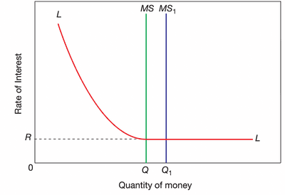

## Keynesian and Monetarist Theoretical Approaches

### **Keynesians**

* economists who think government intervention is needed to achieve full employment (level of GDP).

* Avoidance of unemployment is a key priority.

### **Monetarists**

* economists who argue that control of the money supply is essential to avoid inflation.

* They believe an erratic change in the growth of the money supply will destabilize an already otherwise stable economy.

* They believe the prominent role of government is to control the money supply.

* Reducing unemployment through government spending will only raise inflation in the long run.

### **Liquidity Preference Theory**

* Keynesian concept that explains why people demand money. It was showcased by the sloping curve in the graph below.

* **Transaction Motives**: the desire to hold money for the day-to-day buying of goods and services.

  * Interest is inelastic but income elastic (influenced by income they have and can pay).

* **Precautionary Motive**: a reason for holding money for unexpected or unforeseen events.

  * Income elastic but interest inelastic.

* **Both are known to be active balances** (the amount of money held by households or firms for possible future usage)

* **Speculative Motive**: a reason for holding money to make future gains from buying financial assets. Interest elastic

  * **Known as idle balance** (the amount of money held temporarily as the returns from holding financial assets are too low)
  * Government bonds are an example of hold, 500 dollars face value, with 5% fixed interest. If raised to 1,000 dollars, the interest rate will be 2.5%.
  * Government bonds and interest rates **move in opposite directions** (in percentage).
  * Money is held when bond prices are high and expected to fall.
  * **An increase in money supply** will lead to a **decrease in interest rates**.
  * Interest rates will only fall to a certain level, which will then be ineffective.

* **Liquidity Trap**: a situation where interest rates cannot be reduced to stimulate an upturn in economic activity.
* This shows the **limit of monetary policy** and how increasing the money supply will lead to a limited effect; the interest rate can only go so low; after **a certain point, it won’t have an impact, and people will not bother**.