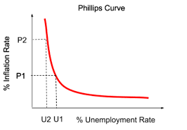
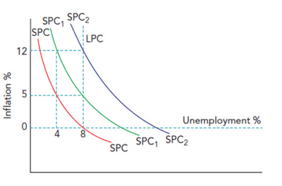

## Links Between Macroeconomic Problems and their Interrelatedness

### **The Relationship Between the Internal and External Value of Money**

* ***++Internal value of money++***: refers to the purchasing power of a nation’s currency within its own economy.
* It will be determined by inflation, subsequent purchasing power and economic performance.
* ***++External value of money++***: pertains to the value of a country’s currency in the international market.
* It will be determined by the foreign exchange value of the domestic currency (fluctuations in its value), trade balance, foreign investment and global economic conditions.
* If the internal value rises above the value of a rival country, demand falls, and the external value falls. 
* A change in **external value will also affect internal value**, **affecting purchasing power**.
* The exchange rate **affects the value of money** both directly and indirectly. The relationship between external and internal value is **direct**.

### **The Relationship Between the Balance of Payments and Inflation**

* A **current account surplu**s causes **short-term** upward pressure on domestic prices due to increased export revenue, **causing inflation**.
* However, due to increased current account surplus, **exchange rates ris**e, and **appreciation** occurs; this leads to **reduced surplus and prices of imported goods**, which puts pressure on **domestic firms to lower prices**, thus **reducing the inflation rate**.
* **Net inflow on financial accounts may reduce inflation** if multinational companies bring advanced technology and increase economic competition pressure.

### **The Relationship Between Growth and Inflation**

* **High inflation reduces economic growth**. Decreases in net exports affect AD, lower the country’s output, or reduce the output rate.
* The r**ise in actual economic growth** may be accompanied by c**ost-push/demand-pull inflation.**
  * **Increasing production** results in more competition for resources, including workers, which raises prices.
  * **Higher output increases income and AD**, and the gap shrinks as the economy approaches full employment.
* **Potential economic growth reduces inflation**, enabling AD to increase without pressure on price levels and reducing production costs.

### **The Relationship between Growth and the Balance of Payments**

* **Higher Net Exports increase GDP**, which leads to **economic growth**. This i**mproves the current account.**
* Potential economic growth can also have this **positive relationship** if product price and quality competitiveness **increase.**
* Possibility of an **inverse relationship in the short-run**, as imports of raw material/capital goods will increase, and the export revenue of these goods has yet to cover those import costs.
* An increase in **current account surplus increases AD**, which results in **actual economic growth.**

### **The Relationship between Inflation and Unemployment**

* **Philips Curve**: a curve that shows the relationship between the unemployment rate and the inflation rate (money wages used as an indicator of inflation) over time.
* The government can select its best combination of unemployment and inflation and trade off the two.
* Depending on the objective, if unemployment should be reduced, expansionary fiscal/monetary policy will be applied to increase inflation and reduce unemployment.

* **Expectation-Augmented Philips Curve**: a diagram that shows that while there may be a trade-off between unemployment and inflation in the short run, there is **no trade-off in the long run.**
* This argument is by **monetarists to challenge Keynesians**.
* They argue that **policy measures used to increase aggregate demand** will **only reduce unemployment in the short run** and will only succeed in increasing **inflation in the long run.**
* Short-run Philips curves (SPC, SPC1, SPC2). AS inflation rises, unemployment falls; SPC shows us that **inflation rises from 0% to 5%**, and **unemployment falls from 8% to 4%.**
* Demand plays an important role in linking inflation and unemployment. When **demand is high**, **business employees need more** to meet these demands; this causes SPC1 and SPC2.
* But as **inflation rises,** businesses realise that their costs are increasing, so they will start to **cut costs, resulting in unemployment.** This is the **long-run Philip curve**. **At this point, no matter how high inflation gets, unemployment will not decrease.**

