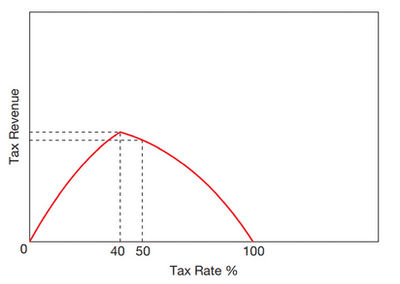

## The Effectiveness of Fiscal Policy in Relation to Different Macroeconomic Objectives

### **Economic Growth and Low Unemployment Vs Balance of Payments Stability and Price Stability**

* **Expansionary Fiscal Policy** increases **actual economic growth** while **reducing cyclical unemployment**; however, it can **increase demand-pull inflation** with a **deficit in the current account.**
* **Contractionary Fiscal Policy** can improve 2 macroeconomic objectives but can worsen/threaten the other two. **Lower AD helps achieve low inflation and balance the current account** but simultaneously **creates higher cyclical unemployment and lower actual economic growth.**

### **Crowding Out and Crowding In**

* **Crowding Out Effect**: the effect of rising public sector spending driving down private sector investment.
* **New classical economists** believe that if spending by the **government is financed through increased borrowing**, that **reduces funds** available to private sectors and **raises interest rates**.
  * The high-interest rate attracts foreign financial investment, increases the exchange rate, **and reduces net exports**.
* **Crowding In Effect**: The effect of rising public sector spending leading to more private sector investment.
  * **Keynesians argue against crowding out** but agree that **crowding in occurs**. Higher government **spending leads to a multiple rise in GDP**. Higher income increases saving increases lending funds, and **encourages consumption**.

### **Unexpected Responses**

* Uncertainty about how households and firms react **depends on their optimism about the future**.

### **Time Lags**

* Risks the policy **reinforcing the business cycle** rather than countering it.
* Governments must **recognise the problem** and determine the most effective policy route. Add to it the time that will be taken for f**irms and consumers to react** to the changes. When that point happens, the **economy could have risen or downturned again**.

### **Redistribution of Income and Development versus the Incentive to Work**

* Fiscal policy’s use of **taxes and government spending** (transfer payments) helps influence income redistribution.
* Government spending also benefits **people by providing healthcare and education services** that help the low-income.
* However, the risk of **reduced incentives to work due to benefits and transfer payments** **worsens income conditions** in the future, e.g., the unemployed may experience greater poverty in the long run than if they had accepted a low-paid job now.

### **The Laffer Curve**

* **The Laffer Curve**: a curve showing tax revenue rising at first as the tax rate increases and then falling beyond a certain point. Tax rates become counterproductive at this point.
* Apart from suggesting where **tax revenue is maximised**, the curve may show how the **same tax revenue may be received at two different tax rates**.

* At **0%,** there is no tax rate, which means **no tax revenue**.
* At **100%,** there is no tax revenue due to **no incentive work**.
* The curve suggests that tax revenue and tax rate have a **positive direct relationship** up and **until the optimal rate**, which, after that, **raises the tax rate** and discourages work and tax evasion, therefore **decreasing tax revenue**.
* The example above shows us that a cut in the tax rate from 50% to 40% will increase tax revenue.
* Economists debate the validity and usefulness of the Laffer curve, as the shape of the **curve may change according to country and time.**