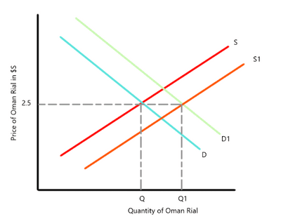
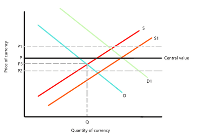
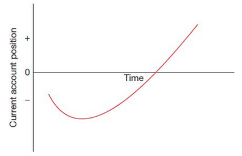
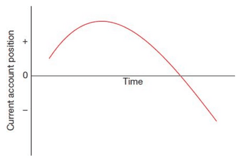

## Exchange Rates

* **Exchange Rate**: the price of one currency in terms of another currency.
  * **Trade-Weighted Exchange Rate**: the price of one currency against a basket of currencies. Also known as the multinational exchange rate.
  * **Real Effective Exchange Rate**: a currency’s value in terms of its purchasing power.
* $\text{Real Exchange Rate: } = \frac{\text{Nominal exchange rate x Domestic price level}}{\text{Foreign price level}}$
* May rise if an appreciation or increase in the country’s relative inflation rate.

### **The Determination of Foreign Exchange Rates**

**Floating Exchange Rate**

* An exchange rate is determined by the supply and demand market forces.
* **Appreciation**: an increase in the international price of a currency caused by market failure.
* **Depreciation**: a decrease in the international price of a currency caused by market forces.

|Advantages of floating exchange rate|Disadvantages of floating exchange rate|
|:---|:---|
|In theory, the exchange rate should restore the balance on the current BOP account, and a floating exchange rate helps with that.|Uncertainty as it constantly changes.|
|It cannot be held and used for ulterior motives like politics by the government.|Discourages trade and involvement.|
|Removes pressure from the government to maintain price stability using policies.|No guarantee that the floating exchange rate will fix deficit or surplus.|

**Fixed Exchange Rate**

* An exchange rate set by the government and maintained by the central bank.

* The central bank maintains it by intervening in foreign exchange and/or changing the interest rate.

* **Hot Money Flows**: Money flows moved around the world to take advantage of changes in interest and exchange rates.

* Maintaining a fixed exchange rate is easier if that rate is set to the long-run equilibrium.

* **Revaluation**: a decision by the government to raise the international price of its currency.

* **Devaluation**: a decision by the government to lower the international price of its currency.

  

* In the graph above,1 rial = 2.5 dollars.

* If the supply shifts to S1, the central bank will buy from the currency to cause it to shift the demand curve right to D1 to maintain currency at 2.5 dollars.

|Advantages of Fixed Exchange Rate|Disadvantages of fixed exchange rate|
|:---|:---|
|Creates certainty, which promotes international trade and investment.|The need to keep reserve, resulting in opportunity cost|
|It imposes discipline on the government to keep inflation low to not affect international price competitiveness and cause a downward pull on the exchange rate.|Risk of sacrificing other policy objectives to maintain a fixed exchange rate.|

**Managed Float**

* Where the exchange rate is influenced by state intervention.
* It involves the government allowing market forces to influence the exchange rate within an upper and lower limit.

* The graph above shows a set central value of P, accompanied by an upper limit of P1 (exchange rate should not exceed) and a lower limit of P2 (exchange rate should fall beyond).
* If the exchange rate is at P3, there is no intervention by the government.
* However, if demand shifts to D1, the central bank will sell domestic currency to match the D1 with a supply shift to S1.

**Marshall-Lerner Condition**

* The requirement for a fall in the exchange rate to successfully reduce a current account deficit is that the sum of the price elasticities of demand for exports and imports must be greater than 1.
* The greater the combined PED for exports and imports, the smaller the fall in the exchange rate required to improve the current account position.
* If the PED is less than 1, a revaluation of the exchange rate would be the more appropriate policy.
* Example:
  * 1 Oman rial = 2.5 US dollars.
  * 20 products in Oman would sell for 20 rials in the home country and 50 dollars in the US. **Export revenue = 400 rials (1000 dollars).**
  * 100 imports from the US, which sell at 20 dollars, are purchased by Oman at 8 rials each. **Import expenditure = 800 rials (2000 dollars).**
  * Deficit = 400 rials - 800 rials = 400 rials.
  * Then Oman rials fall in value, **1 Oman rial = 2 US dollars**.
  * The price in the US falls to 40 dollars each. Total export revenue is now **20 x 40 dollars = 800 dollars**, which is now converted to **400 Oman rials**, leaving export revenue in **Oman rials unchanged.**
    * PED for exports = 0.
  * The price of the 20-dollar product will rise to 10 Oman rials, a 50% increase. **Demand falls by 55% to 55**. Total import expenditure is now 550 rials.
    * PED for Import = -1.1
  * The deficit = 400 rials - 550 rials = 150 rials, it fell by 250 rials.

**J-curve Effect**

* The J-curve effect shows us that, in some cases, a fall in the exchange rate causes an increase in a current account deficit before it reduces it due to the time it takes for demand to respond.

* This is due to demand for imports and exports being **price inelastic in the short run.**

* In the long run, demand becomes more elastic, and the current account position moves to a surplus from a deficit, as shown below.

  

* **Marshall–Lerner condition and the J curve** work in reverse, too.

* The current account surplus will only be reduced if PED, for exports and imports, is greater than 1. A rise in the exchange rate may increase a current account surplus in the short run before reducing it in the longer run.

