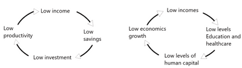
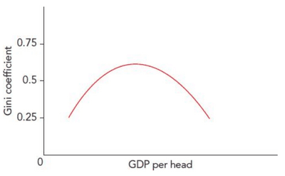

## Economic Development

### **Classification of Economies in Terms of Their Level of Development**

* **Development Economics** considers factors such as health, education, working conditions, domestic and international policies, and market conditions, focusing on improving conditions in the world's poorest countries.
* **Developed Economies**: an economy with a high GDP per head.
  * Range of well-established economic institutions
  * Advanced technological infrastructure
  * Strong tertiary sector
* **Developing Economies**: an economy with low GDP per head, reliance on fewer products, a larger primary sector, and lower productivity.
  * **Poverty Cycles**: the links between, for example, low income, low saving, low investment, and low productivity.
  * **Development Traps**: restrictions on the growth of developing economies arising from low savings and investment levels.

* **Emerging Economies**: economies with rapid growth rates that provide good investment opportunities.
* The problem with classification is that, in a sense, all economies are developing or seeking to develop.
* Classification by institutions and economists is now based on the level of development (e.g., Human Development Index) economies have reached or according to income per head.

### **Classification of Economies in Terms of Their Level of National Income**

* **GDP per capita (per head)** is calculated by dividing a nation's GDP by population.
  * It shows us, on average, the economic output per person. The higher the GDP per capita, the more well-off in the economy.
* GNI per capita is calculated by dividing a nation's GNI (Gross National Income) by population.
* The World Bank uses GNI per capita to classify every country as low-income, lower, upper, or high-income.

|Threshold|GNI per capita, 2023-FY24 (Future Year) ($) \n (New)|GNI per capita, 2022-FY23 ($) \n (Previous)|
|:---|:---|:---|
|Low-Income|$\leq{1,135}$|$\leq{1,085}$|
|Lower-middle Income|1,136 – 4,465|1,086 – 4,255|
|Upper-middle Income|4,465 – 13,845|4,265 – 13,205|
|High-Income|>13,845|>13,205|

### **Indicators of Living Standards and Economic Development**

### **Monetary Indicators**

* $\text{Real GDP per capita} = \frac{\text{GDP at constant prices}}{\text{Population of country/area}}$
* $\text{GNI per capita} = \frac{\text{Dollar value of a country's final income in a year}}{\text{Its population}}$
* **NNI (Net Nation Income)** = gross national income minus the depreciation of fixed capital assets.
* **Purchasing Power Parity (PPP)**: a way of comparing international living standards by using an exchange rate based on the amount of each currency needed to buy the same basket of goods and services.
* One of the issues related to comparisons is the understated true change in output in the official real GDP, GNI, or NNI figures.
  * **Shadow Economy:** the output of goods and services not included in official national income figures.
  * It can occur due to evading tax authorities or concealment of illegal activities.
  * It can be measured using the gap between GDP and the output by measuring expenditure and income.
* Other data accuracy issues are low literacy levels, non-material goods and services (e.g., voluntary work), and measuring government spending.

### **Non-Monetary Indicators**

* Life expectancy, education levels, and access to healthcare.
* These help measure a country's citizens' quality of life and well-being, which is important in considering economic development.

**Composite Indicators**

* **Human Development Index (HDI)**: a composite measure of living standard that includes GNI per head, education, and life expectancy.
  * HDI value shows the total data to be covered to reach 1:
    * Very high HD, high HD, medium HD, low HD.
* **Measurable Economic Welfare**: a composite measure that seeks to give a fuller of living standards by adjusting the GDP figure to consider other factors that impact living standards.
  * It isn't easy to measure and expensive, as it involves non-market goods and services.
  * Factors improving living standards (including increased leisure time) are added to the GDP figure.
  * Factors reducing living standards (e.g., environmental damage) are deducted from the GDP figures.
  * In practice, putting monetary value on non-marketed goods and services is challenging.
* **Multidimensional Poverty Index (MPI)**: a composite measure of deprivation in terms of the proportion of households that lack the requirements for a reasonable standard of living.
  * Six living standard indicators (cooking fuel, sanitation, safe drinking water, floor space, and assets) equal 33% of total weight.
  * Two indicators of education (years of schooling and attendance) equal 33% of total weight.
  * Two indicators of health (child mortality and nourishment) equal 33% of total weight.
  * Households are considered multidimensionally poor if deprived of at least 33% of the weighted indicators.
* **The Kuznets Curve:** a curve that shows the relationship between economic growth and income inequality.

* As an economy develops, income becomes less evenly distributed until it reaches a certain point it becomes evenly distributed.
* This is because only a few gain high rewards as the economy develops, so there is a broader income gap. However, a middle grade emerges due to progressive tax, and more income is spent on social welfare and public goods.
* Only applicable to developing countries. It does not explain the rise in inequality in developed.
* All developing countries do not use it.