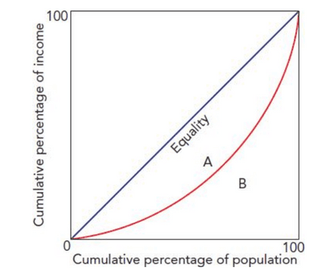

## Characteristics of Countries at Different Levels of Development

### **Population Growth and Structure**

**Demographic Factors**

* **Birth Rate**: the number of live births per thousand population in one year.
  * $\frac{\text{Number of live births}}{\text{The total population}}\text{x 1000}$
  * It is also referred to as **~~crude birth rate~~,** as it only gives basic information on births (not, for example, the mother's age).
* **Death Rate**: the number of deaths per thousand population in one year.
  * $\frac{\text{Number of death}}{\text{The total population}}\text{x 1000}$
  * Death rates include children under 1, even tho infant mortality is measured separately.
  * **The natural increase in population** is when the birth rate exceeds the death rate.
* **Infant Mortality**: the opposite of Birth rate, the number of deaths of children under 1 per thousand of the population in one year.
* **Net Migration**: The difference between migration into and out of a country divided per thousand
  * $\frac{\text{Difference between immigration and emigration}}{\text{The total population}}\text{x 1000}$
  * If immigration into the country is greater than emigration out, net immigration or positive net migration happens.

**Causes of population changes:**

* As countries develop, **population growth goes down**. **The death rate decreases**, but the **birth rate drops more.** This is due to a decline in infant mortality, increased cost of raising children and women’s participation in the labour force, better healthcare, housing, nutrition, etc., contributing to people living longer.
* **Population growth** can still occur in these countries through **increased net immigration** (higher living standards and income attract people).
* **Low developmen**t is associated with **high population growth rates** due to the **birth rate exceeding the death rate**.
  * The need for children to support parents, lack of availability/methods of birth control, low cost of raising kids, lack of education for women and high infant mortality (more children to compensate).
  * This results in a **low average population age** and a **high dependency ratio** (people who can’t be in the workforce must be provided for).
* High development creates an **ageing population** (due to a decreasing birth rate and a decreasing death rate), and this also makes a **high dependency ratio** and **greater cost for health care and pensions.**
  * Governments have i**ncreased** the **retirement age to reduce the cost of pensions.**

**The Optimum Population**

* **Optimum Population**: the size of the population that maximises GDP per head.
* As the population grows, it makes better use of the stock of capital and land. This increases returns enjoyed by population growth.
* A country is considered underpopulated if the population is below the optimum level.
* The country is considered overpopulated if the population exceeds the optimum level, and decreasing returns are happening.
* In practice, the situation is more dynamic (constantly in change). Technical knowledge is continually improving, and due to the number of other factors constantly changing, there is no fixed optimum population for a country.

**Level of Urbanisation**

* Countries with low income per head usually have a high proportion of the population living in rural areas.
  * Rural-urban migration rates are high in these countries, putting pressure on the urban areas' infrastructure, housing and schools.
* Most of the population in countries with high income per head live in urban areas, so they have small growth in urban population.
  * In some cases, people are migrating to rural from urban due to technological advances allowing more “work from home”.

### **Income Distribution**

 

* **Gini Coefficient**: a numerical measure of inequality
  * Calculated as, $\frac{\text{Area A}}{\text{Area A + Area B}}$
  * If the distribution is equal, the coefficient is 0.
  * A coefficient of 1 would mean complete inequality (one person getting all the income).
  * The higher the coefficient, the more unequal the distribution of income.
* **Lorenz Curve**: a graphical representation of inequality.
  * The 45° line shows a completely equitable distribution of income.
  * The curve shows the actual distribution of income or wealth.
  * Area A is the difference between the curve and the line. It represents inequality; the smaller the Area of A, the more equal the distribution.

### **Economic Structure**

* **Primary Sector**: extraction of natural resources to be used and processed into goods and services.
  * Agriculture and Extractive Industries.
* **Secondary Sector:** the manufacturing of goods and services from natural resources.
  * Manufacturing industries and construction industries.
* **Tertiary Sector**: Service industries to both consumers and firms.
* Countries with **high income per head and high development** have a large portion of their labour force in the **tertiary sector**.
  * They export mainly manufactured goods and services.
* Countries with **low income per head and development** depend more on the **primary sector**.
  * More **vulnerable to natural forces**, High rain seasons/droughts will affect agriculture-dependent economies, leading to famine, and if they are exported to almost no foreign currency earning.
  * The majority of Export revenue is generated from primary products. **Frequent and significant fluctuations in price** (through demand and supply changes) make them **vulnerable in their trading relations.**
* **Industrialisation** of the economy (due to economic development)

  will increase the relevance of the secondary sector, and this will move the labour force from the primary industry, reducing its significance.
  * Primary goods are **inelastic,** with manufactured ones being more **elastic**. **Low prices and revenue** for direct goods compared to manufactured goods make them hard to export, creating a **decline in primary goods.**
* As the economy develops, the employment of the labour force will continue shifting towards the tertiary sector. **Increases the value of output due to higher labour and capital productivity**.

