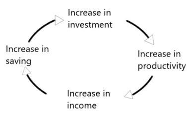

## Relationships Between Countries at Different Levels of Development

### International Aid

* **Foreign Aid**: assistance given to developing economies on favourable terms.
* **Tied Aid** comes with conditions
* **Untied Aid** is given without conditions
* **Bilateral Aid** is given to one country by another.
* **Multilateral Aid** is given by countries to international organisations, who distribute it to other countries.
* **Voluntary Aid** incorporates volunteers who donate their labour as a form of aid.
* **Official Development Assistance (ODA)**: government aid that promotes and specifically targets developing countries' economic development and welfare.

**Reasons for Aid**:

- **Tied, bilateral aid may be given to promote the industries** of the donor country through sending aid and expecting the recipient country to invest/spend on products from the donor country, restricting its import. **Increases donor countries’ exports.**
- **Untied aid may promote the donor country’s export**s through better economic growth in the recipient country, as they may **import more** due to a **good relationship**.
- **Bilateral aid** may be used to gain **political influence.** The recipient government may be **pressured or inclined to support the donor government** in its disputes with other government(s).
- Both **bilateral and multilateral aid** may be given to **influence the economic policies** of the recipient government. E.g. Aid given on the condition ends the use of - Bilateral and multilateral aid can be given for humanitarian motives, such as crisis aid (to save lives during natural disasters and famines). The development of other countries increases global GDP and international trade and reduces the risk of negative external shock.

**The effects and importance of aid:**

- Aid helps the recipient country **experience increases in its income per head and development** by providing investment/finance to stimulate them.
- If investment is encouraged, a virtuous cycle may be created.

- **Dependency:** a situation where the economic development of the recipient economy is hindered by its relationships with donor economies.
- Recipients may become indebted, with high-interest payments, for past loans to high-income countries; they may be paying more than the aid received.
- Aid in terms of advice and policies suggested/imposed may not always be suitable towards the recipient country.

### Trade and Investment

- Low-income/some middle-income countries **favour trade more than aid.** International **trade has many benefits compared to aid**:
  - **Economies of scale** are becoming possible because of the larger market.
  - **Increased competition** encourages domestic entrepreneurs to **innovate** and look for **new production techniques**.
  - Trade leads to the **transfer of skills and technology**.
  - Specialisation and trade **increase income** and provide **increased savings** that can be used for **investment**.
  - Expansions caused by trade **increase employment**, expand **spending power** and **increase demand** for domestic output.
- Low-income/middle-income countries specialise in agricultural products, this puts them at a disadvantage due to:
  - The income elasticity of demand for primary goods is very **inelastic**, causing **little extra demand with increased world income.**
  - Producers of manufactured goods in high-income economies have some **monopoly power**, which helps maintain their high prices. Puts primary goods at a disadvantage in trade.
  - **Subsidies** provided in the USA and Europe put downward pressure on global agricultural prices. **Unfair competitive advantage** due to subsidies and a **deflated global price.**
- Countries adopt **import substitution policies** (less import of manufactured to develop their own manufacturing industries) and **attempt to diversify their economies** in attempt to combat these exploitative trading patterns.
- **Export-led growth** through industrialisation gives them a more comparative advantage in industries previously dominated by high-income economies.
- Investment flows between countries in search of profits, interest and dividends.
- Many low-income/middle-income countries incur a **deficit in their current account**, which makes investment impossible unless a **surplus in the financial** account covers it. This makes Low income/middle income countries seek to **attract direct and portfolios from other countries.**

### Role of Multinational Companies (MNCs)

- **Multinational Companies (MNCs)**: a business with a parent company based in one country but with production or service operations in at least one other country.
- **The Beneficial activities of MNCs:**
  - Bring in new technology and new ideas into host countries.
  - Add to GDP and exports, contributing to the economic welfare of the host country.
  - Generate employment opportunities
  - Led to an increase in Foreign direct investment (FDI)
- **Negative consequences of MNCs:**
  - It may d**rive domestic firms out of the market** (especially infant and declining industries), but this does **not create higher employment**.
  - **Depletion of non-renewable resources** and the creation of **pollution.**
  - May send **profits back to home country** and **employ foreign** rather than domestic workers.
  - Depending on MNCs’ power, it may **pressure the government** into employing policies that benefit them but not the economy and negotiate favourable tax breaks and exemptions from some environmental laws.
  - Monopsony Power may be developed, which gives them the **power to drive down prices of raw material supplies** in the host country.

### Foreign Direct Investment (FDI)

- **Foreign Direct Investment (FDI)**: setting up production units or purchasing existing production units in other countries. It is not the same as a portfolio investment (purchasing shares in another country).
- Low-income/middle-income countries benefit from FDI through MNCs, which helps the country’s infrastructure.
- **Large inward flows of FDI** indicate that a country is expected to grow rapidly and provide large markets for MNCs or markets with low production costs or an a**bundant supply of raw materials.**
- **Measures to attract FDI:**
  - Low corporation tax
  - Good education system
  - Few rules and regulations for firms.
  - Government subsidies

### External Debt

-**External debt includes:**

- Loans have not been repaid, and interest payments on loans have not been made to foreign banks, governments and international organisations.
- **Causes of Debt:**
  - Structural current account deficit
  - Overconfidence in the value of loans that could be repaid.
  - Inefficient use of borrowed funds
  - Unexpected events
- **Consequences of Debt:**
  - The opportunity cost of repaying debt with the welfare of the population.
  - A high level of debt may make it difficult for low-income/middle-income countries to attract more development funds.

### Role of the International Monetary Fund (IMF)

- **The International Monetary Fund (IMF)** works to achieve sustainable growth and prosperity for its 190 member countries.
  **The primary aim of IMF:**
- To promote international monetary cooperation
- To facilitate the expansion and balanced growth of international trade
- To promote exchange rate stability
- To assist in setting up a multilateral system of payments
- To make resources available (with adequate safeguards) to members experiencing balance of payments difficulties.
- These activities create a stable system of international payments and exchange rates necessary for trade between 2 countries.

**Functions of IMF**:

- **Surveillance and technical assistance**, which encourages countries to adopt sound economic policies, helps promote global growth and economic stability.
- **Lending** is used to help members experiencing difficulties in financing their balance of payments.

### Role of World Bank

- The World Bank is an international development organisation owned by 187 countries.
- The World Bank supports low/middle-income countries through **internal investment payments** such as building new roads, improving infrastructure and constructing new health facilities.
- **The International Bank for Reconstruction and Development** (IBRD) assists middle-income and creditworthy poorer countries, while the **International Development Association** (IDA) focuses on the poorest economies, which are given grants.
- **They provide loans that cover the following:**
  - **Health and education**
  - **Agriculture and rural development**
  - **Environmental protection**
  - **Infrastructure**
  - **Governance (anti-corruption reasons)**
- These loans are given to recipients who want to create wider-reaching changes to their economic policies.