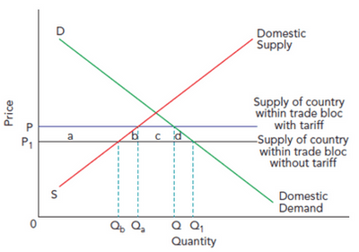
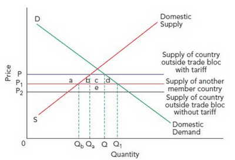

## Globalisation

- **Globalisation:** increasing interdependence of world economies due to the growing scale of cross-border trade of commodities and services, the flow of international capital and the vast and rapid spread of technologies.

**Causes of globalisation:**

- **Reduction in trade barriers** - makes product, capital and labour markets easily accessible for different countries.
- **Improved telecommunications** - more accessible to keep in contact with production plants, making coordinating the production process easier. The increase in online stores makes consumption more convenient.
- **Reduced supply chain costs** - improved transport, as made resource mobility easier and cheaper.
- **Deregulation of financial markets** - more freedom for banks to use and allocate their capital, increase in foreign direct investment, portfolio and direct investment.
- **Technological change** - technological advancement has made many processes more efficient and effective.

**Consequences of Globalisation:**

- **Improved standards**: Increases comparative advantage, allows for increased GDP and economic growth and increased living standards.
- **Increase of Foreign Direct Investment**: Reduced trade restrictions attract MNCs, which increases FDI.
- **Greater Variety of Products**: removal of trade restriction encourages imports.
- **Structural Unemployment**: Industries expand due to greater international competition while some decline.
- **Interdependence of Economies**: the increased possibility of demand and supply side shocks; these may be adverse shocks like natural disasters.
- **International investment**: free flow of portfolio and direct investment runs the risk of a negative multiplier effect if economic conditions worsen and the investment is drawn out quickly.
- **International Coordination of Policies:** to prevent policy conflicts and improve the effectiveness of policies, but not very easy to achieve.

### Economic Integration

- **Economic Integration**: an arrangement among nations that typically includes reducing or eliminating trade barriers and coordinating monetary and fiscal policies.
- **Trade Blocs**: a regional group of countries that have entered trade agreements.
- **Free Trade Areas:** a trade bloc where member governments agree to remove trade restrictions among themselves and determine their external trade restrictions/policies towards non-members. E.g. NAFTA.
- **Custom Unions**: a trade bloc with free trade between member countries and a common tariff on imports for non-members. E.g. SACU
- **Monetary Union**: a trade bloc with free trade between member countries, a common external tariff, the same currency, and the same monetary and exchange rate policies. E.g. EU
- **Economic Unions**: a trade bloc with free trade between member countries, a common external tariff, economic policies, and a common currency. E.g. 7, the original states joining together into the UAE or the 13 states that formed the USA.
  - The full economic union is the final stage of integration.

### Trade Creation and Trade Diversion

- **Trade Creation**: where high-cost domestic production is replaced by more efficiently produced imports within the customs union.
- Before joining the customs union, the price was P and quantity Q (Qa supplied by domestic producers, Qa- Q is the amount imported).
- After joining the customs union, it can import without tariff, which pushes the price to P1 and increases quantity to Q1.
- Here, consumers gain low prices and high quantity, while firms lose sales and lower prices. This could be because of a resource shift to specialise in price-competitive goods.
- Lower price increases consumer surplus by a, b, c, d amount.
- Producer surplus falls by an amount and tariff revenue by c, giving a net gain of b and d.

- **Trade Diversion**: where trade with low-cost countries outside a customs union is influenced by higher-cost products supplied within.
- Initially, the country bought from the most efficient country and placed tariffs on imports, price at P and quantity at Q, with tax being c + e.
- The trade is switched to another member country when joining the customs union. Price falls to P1, and quantity rises to Q1.
- Consumer surplus increases by a, b, c, d amount.
- If producer surplus falls by an amount, tariffs will decrease by c+ e.
- If areas b and d are less than area e, welfare will be reduced.

