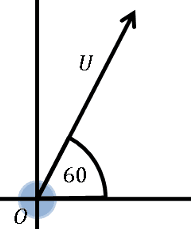
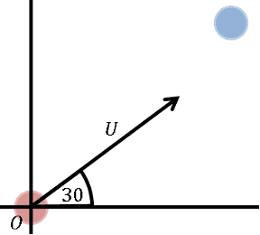
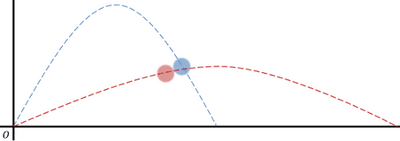

## __Displacement__

* The distance the particle has moved from the origin.
* Displacement is dependent on initial velocity and acceleration, or final velocity and acceleration:

$s_x = u cos(\theta) t$ $s_y = u sin(\theta) t - \frac{1}{2} gt^2$ 

* These can be derived from one of the SUVAT equations: $s = ut + \frac{1}{2} at^2$

---

### Sample Question

**Question:**

A ball was projected at an angle of $60\degree$  to the horizontal. One second later another ball was projected from the same point at an angle of $30\degree$ to the horizontal. One second after the second ball was released, the two balls collided. Show that the velocities of the balls were $12.99ms^{­­-1}$ and $15ms^{-1}$. Take the value of $g$ to be $10ms^{-2}$.

**Solution:**

Visualise the scenario:

At zero time:

 At $t = 1$ 

 At $t = 2$ 

 Let velocity for first ball be $U_1$ and second ball be $U_2$

Displacement from origin is equal for both at impact.

$\therefore$ $r_1 = r_2$ 

$r_1 = (U_1 (2) cos 60) i + (U_1(2) sin 60 - 5(2)^2)j$

$r_2 = (U_2(1)cos30)i + (U_2(1) sin30 - 5(1)^2)j$

Equate horizontal components:

$\therefore$ $2U_1 cos 60 = U_2 cos30$

$U_1 = \frac{\sqrt3}{2}U_2$

Equate vertical components and substitute info above: 

$\therefore 2U_1 sin60 - 20 = U_2 sin30 - 5$ 

$(2(\frac{\sqrt{3}}{2}) (\frac{\sqrt{3}}{2}) - \frac {1}{2})U_2 = 15$

$U_2 = 15ms^{-1}$

Find $U_1$ 

$U_1 = \frac{\sqrt{3}}{2} (15) = 12.99ms^{-1}$

