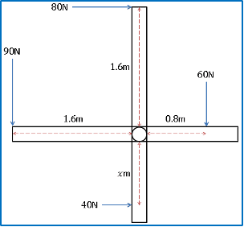

# Equilibrium of a Rigid Body

## Moment of a Force

Moment of a force = $\|F\| × d$

$\|F\|$: magnitude of the force

$d$: $\underline{perpendicular}$ distance from pivot to point of force

* Units: Newton-metre $(Nm)$

* Moments are vector quantities and act clockwise or anticlockwise around a pivot.

* Clockwise is generally considered as positive direction.

* **Principle of Moments:** When a system is in equilibrium the sum of anticlockwise moments is equal to the sum of clockwise moments, and there is no net moment about the pivot.

  $Anti-clockwise \ moments \ = Clockwise \ moments$

---

**Sample Question:**

The diagram shows an aerial view of a revolving door. Four people are exerting forces of $40N$, $60N$, $80N$ and $90N$ respectively as shown. Find the distance $x$ if the total moment of the forces about $O$ is $12Nm$.

**Solution:**

Use the sum of turning forces equation:

Clockwise moments + Anticlockwise moments = $12Nm$

Find clockwise moments:

$$

(80 \times 1.6) + (60 \times 0.8) = 128 + 48 = 176

$$

Find anticlockwise moments:

$$ 

-((90 \times 1.6) + (40 \times x)) = -(144 + 40x)

$$

Substitute back into formula and solve for $x$:

$$

176 + (-(144 + 40x)) = 12

$$

$$

176 - 144 - 40x = 12

$$

$$

x = 0.5m

$$